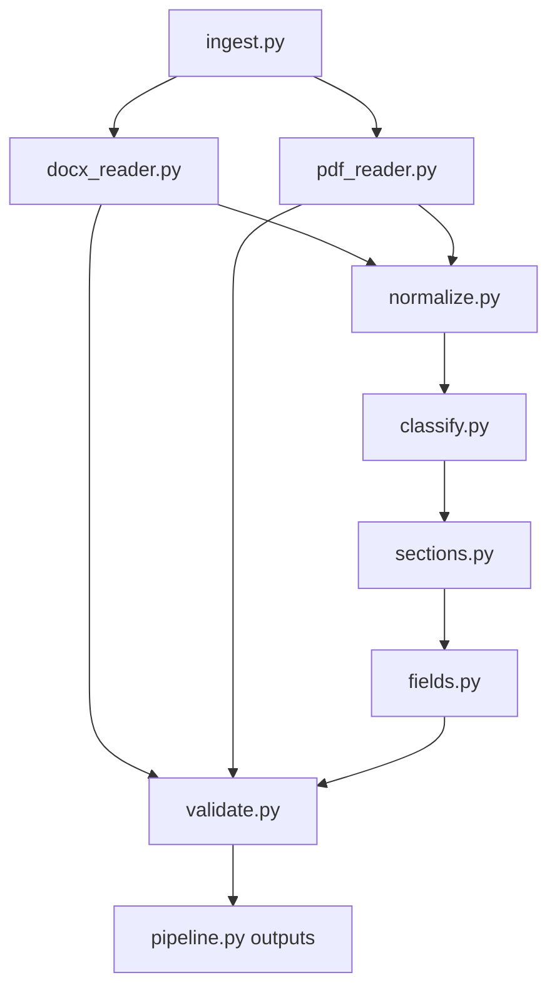

# Deterministic resume extraction — version 2

An offline Python engine that preserves resume text, maps variable headings to stable database keys, and extracts evidence-backed fields. There are no language models, transformer models, external AI calls, or runtime network requests.

The supplied 19 digital resumes have been extracted into `outputs/`. A convenient copy of each raw text file, under its original bundle and resume name, is in `extracted_text/`. Each input has a raw text file, normalized text, Markdown with headings, structured JSON, and a quality report. See `reports/ACCURACY_REPORT.md` for measured results and `reports/REMAINING_FAILURE_CASES.md` for limits.

**Evaluation scope:** the ZIP archives supplied descriptions but no gold JSON. The included gold annotations were explicitly authored from their source content during this build. Rules were developed against these files. Results are development-set measurements, not independent validation or a guarantee for unseen resumes. Four personas recur across bundles; metrics also report the 15 distinct personas.

## Start here: consistent structured output

**Use `structured.json` for your application/database and `structured.md` for a
readable view.** `resume.json` remains the full audit record; `raw.txt` remains
unchanged reader-order text. See `STRUCTURED_OUTPUT_GUIDE.md` for field meanings,
review handling, examples and limitations.

Version 2 repairs aligned PDF date/location columns before section detection,
attaches detached bullet glyphs, handles contiguous international phone numbers
and whitespace around email `@`, and creates education, project, explicit skill
category and certification records. Every extracted field/record keeps source
line IDs. The top-level schema version is now `2.0.0`; consumers of version 1
must accept the added `structured` object and email provenance properties.

The uploaded example has been reprocessed in `results/uploaded_sample/` using
its saved coordinates. Its original PDF was not supplied, so original-PDF text
completeness and missing hyperlink targets remain unverifiable. Old reports
are retained for history; `reports/V2_VALIDATION.md` describes this update.

## Install and run

Python 3.10 or newer is required; testing used Python 3.12. Use a virtual environment:

```bash
python -m venv .venv
# Linux/macOS:
source .venv/bin/activate
# Windows PowerShell: .venv\Scripts\Activate.ps1
python -m pip install -r requirements.txt
python -m resume_extract /path/to/resume.pdf --out out/
python -m resume_extract /path/to/folder --out out/ --config config.yaml
```

System dependencies:

- Poppler: `pdftotext` is the independent PDF completeness reference; `pdffonts` helps detect missing text layers. `pdftoppm` is required for OCR rasterization. On Debian/Ubuntu these are in `poppler-utils`.
- Tesseract with the configured language data (`eng` by default) is required for scanned or fewer-than-20-word pages. OCR is strictly local and invoked only for fallback pages.
- LibreOffice/`soffice` is needed only for legacy `.doc`. That executable was unavailable in the build environment; real `.doc` conversion has not been integration-tested. Conversion uses an isolated profile and a configurable timeout.

You can also install the package with `python -m pip install .` and use the `resume-extract` command. No installation or network is needed after dependencies are provisioned.

File magic determines the format, not the extension. An OLE container must contain a WordDocument stream. UTF-8/UTF-16 text is supported; use `--include-txt` for text files in directories. Direct text-file input is always accepted. Directory mode recursively processes DOCX/PDF/DOC, skips other files and excludes the output directory. ZIP inputs must first be unpacked. Each file gets a deterministic path-derived output directory, so identical filenames in different bundles cannot overwrite each other.

Exit status is 1 on extraction errors, strict completeness failures, schema failures, or no inputs. An unverifiable OCR/reference result does not fabricate a success score: it is flagged in quality and needs_review. Batch mode processes remaining files after an error and writes `batch_summary.json`.

## Architecture



| Module | Responsibility |
| --- | --- |
| `ingest.py` | Content detection, SHA-256 identity, duplicate flags, isolated legacy conversion |
| `docx_reader.py` | Direct OOXML traversal: interleaved body paragraphs/tables, real cells, nested tables, wrappers, hyperlinks, breaks, tabs, text boxes, headers/footers, run styles |
| `pdf_reader.py` | Font/color-aware words, table cell ownership, recursive whitespace cuts, page-level local OCR |
| `normalize.py` | NFKC, ligatures, bullets, conservative wraps, split dates, exact margin-repeat annotations |
| `classify.py` | TITLE / SUBTITLE / H1 / H2 / BULLET / TEXT, visual/lexical rules, inline heading splits |
| `sections.py` | Synonyms, full-string RapidFuzz threshold 90, original headings, explicit custom fallback |
| `fields.py` | Names, contact fields, date intervals, degrees, GPA, skill mentions and grouped experience |
| `validate.py` | Word multiset comparison, schema checks, low-confidence review routing |
| `pipeline.py` | Orchestration, CLI and stable output files |

`models.py` holds the lossless intermediate representation. `config.py` reads rules. Numeric heuristic thresholds, synonym tables, regex rules and the skill gazetteer live in `config.yaml`. Its syntax is JSON, a valid YAML 1.2 subset, to avoid requiring a non-approved YAML library. Keep JSON-compatible syntax when editing. The root file is the editable example; the package copy is the CLI default. Pass `--config config.yaml` to use root edits. Each result records a config hash.

## Database heading mapping

Use `sections[].canonical` as the database key, and keep `original_heading`, `heading_line_id`, `line_ids`, `text`, and `confidence` alongside it. Do not store only the canonical key: that would lose the author's original section label and evidence.

| Original heading examples | Database key |
| --- | --- |
| Professional Summary / Executive Profile / Creative Profile | `summary` |
| Career History / Internship Experience / Academic & Research Appointments | `experience` |
| Technical Skills / Growth Toolkit / Core Competencies | `skills` |
| Education / Academic Qualifications / Education & Credentials | `education` |
| Certifications / Credentials / Licenses | `certifications` |
| Selected Peer-Reviewed Publications | `publications` |
| Honors, Grants & Fellowships / Awards & Honors | `awards` |
| Academic Project & Leadership | `projects` |
| Unrecognized typographic heading | `custom` with exact original label |

Additional canonical keys are `contact`, `metrics`, `languages`, `volunteering`, `interests`, and `references`. Content before a section or around the candidate name is retained under `preamble`. Compound headings use the configured primary category; an inline `Certifications:` label starts its own section. Unrecognized content is never thrown away.

Suggested relational model: a resume row keyed by source SHA, a section table with resume key + ordinal + canonical + original label + content, and an evidence-backed field table or JSON column. Repeated sections remain distinct records. `duplicate_of` flags identical input bytes without skipping output. No database credentials or database-specific dependency is required.

Python usage:

```python
from resume_extract import extract

resume = extract("candidate.docx")
for section in resume["sections"]:
    print(section["canonical"], section["original_heading"], section["text"])
for issue in resume["needs_review"]:
    print(issue["path"], issue["reason"])
```

## Output and preservation contract

| File | Meaning |
| --- | --- |
| `raw.txt` | Reader-order text before normalization and repeat suppression |
| `source.txt` | Independent DOCX XML text baseline or Poppler raw PDF text |
| `normalized.txt` | NFKC/bullets/wraps with exact repeated margins suppressed |
| `resume.md` | Same classified content with Markdown headings |
| `structured.json` | Stable application records, evidence, review list and explicit section order |
| `structured.md` | Formatted application view in canonical section order |
| `resume.json` | Schema, raw/normalized text, original and transformed lines, sections, fields and review items |
| `quality.json` | Strict completeness, schema errors, warnings and suppressed repeat IDs |

“Lossless” here means measured word preservation against the specified text reference, not binary, layout or character-for-character fidelity. Raw run text, formatting and source IDs remain available. `(cid:NNN)` is decoded to a bullet at the PDF reader boundary, with the undecoded token retained in `Run.original_text`. Caps is presentation metadata; original XML case is preserved. Automatic DOCX list numbering is marked through `bullet`, without inventing numbered words absent from XML.

Completeness is **case-sensitive Unicode word multiset equality**, retaining multiplicity. It does not ignore duplicate words or case. Missing OR extra words fail, and exact counts are reported. Punctuation-only differences, whitespace and reading order are outside this metric; ordering is checked separately in layout fixtures. PDF references use `pdftotext -raw`. DOCX references are an independent XML text walk over document/header/footer/footnote/endnote parts, concatenating adjacent runs and retaining structural separators. Unicode compatibility normalization and hyphen joins can change tokens in the normalized view; the strict gate audits the preserved raw view, not that transformed view.

No source text is removed to make a check pass. Repeated header/footer lines are suppressed only in the normalized/Markdown view, only on exact text matches in identified margins/parts; all original occurrences and `duplicate_of` links stay in JSON and raw text. Identical lines in the body are retained. PDF margin detection itself is a heuristic.

Each field candidate includes confidence and source line IDs. Values below 0.8 enter `needs_review`. Scores are transparent rule scores, **not calibrated probabilities**. Name fallback candidates are low confidence. Fictional 555 numbers are retained even if phonenumbers considers them invalid and are routed for review. OCR file field/section confidence is capped at 0.7. Email validation disables DNS checks. Missing optional values are represented without inventing data.

The skill list is a small curated seed gazetteer, in the style of an occupational skill vocabulary; it is **not a full licensed ESCO or O*NET export**. Skills are mentions, not proof of proficiency. Longest overlapping phrase wins; aliases include JS → JavaScript. Add vocabulary/aliases to the config for your domain. The legacy location candidate list emphasizes US city/state patterns; the structured contact view additionally recognizes isolated city/region strings. The default phone region is US and is configurable; explicit +country-code numbers work independently of that default.

## Tests and reproducible metrics

```bash
python -m unittest discover -s tests -v
python tools/evaluate.py tests/corpus --gold tests/gold --out reports/accuracy.json
python -m resume_extract tests/corpus --out outputs/
```

- `tests/corpus/`: all supplied resumes and original guides, unchanged.
- `tests/gold/`: one explicit source-hashed annotation JSON per supplied resume.
- `tests/fixtures/`: synthetic sidebar, hero, grid, dark background, academic repeat-margin, DOCX edge-case, and scanned examples.
- `reports/layer_*.log`: actual test output after each layer.
- `reports/accuracy.json`: per-field TP/FP/FN, precision/recall/F1, per-file errors and distinct-persona metrics.
- `tools/author_gold.py`: literal annotation definitions and source hash binding; it never reads predictions. Changing these labels constitutes a new benchmark version.
- `tools/build_fixtures.py`: fixture generation using pypdf, python-docx and pdf2image, with local Poppler rasterization.

The supplied-file test blocks socket connections and compares repeated extraction results. The schema is in `resume_extract/schema.json`; the stdlib validator implements the schema features used there (not arbitrary JSON Schema). Determinism is for identical file bytes, config, dependency versions, OCR data and external binaries. There is no current-date-dependent date parsing or random behavior.

Before production acceptance, have a second person adjudicate these development labels and run a separately labelled, previously unseen set. Your requested targets are configurable and measurable; they cannot be promised across all resume templates.
