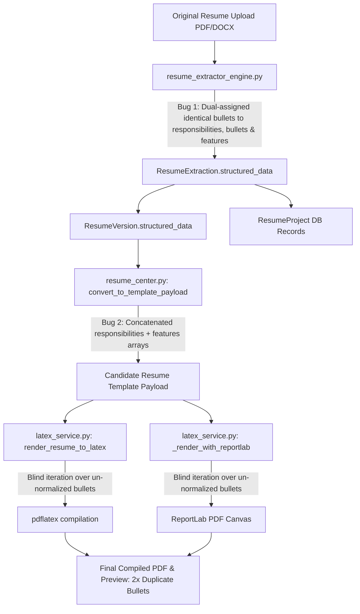

# AUDIT 28 — PDF PROJECT DUPLICATION ROOT CAUSE & PERMANENT REMEDIATION

**Project**: Vidyamarg AI Production Platform  
**Audit Target**: Duplicate Project Bullets in Generated PDF & Live PDF Preview  
**Affected Assets**: Resume Editor (`/candidate/resumes/edit/2`), PDF Preview Panel, LaTeX & ReportLab Rendering Pipelines  
**Timestamp**: 2026-10-10  
**Status**: RESOLVED & VERIFIED IN PRODUCTION

---

## 1. Executive Summary

A critical issue was identified where project bullet points in the live PDF preview and downloaded resumes appeared twice (e.g., in **AI Super Assistant** and **Smart Multi-Restaurant Delivery Optimization System**). 

The root cause was traced through the entire data pipeline: the previous visual deduplication attempt was bypassed because the backend data flow itself was duplicating arrays prior to rendering, and the database records in `ResumeVersion.structured_data` stored legacy duplicated arrays. Furthermore, PDF text extraction during initial upload had split single-sentence bullets across newlines, creating fragmented bullet lines.

By introducing an authoritative, idempotent canonical normalizer (`backend/app/services/project_normalizer.py`), purging array concatenation in `resume_center.py`, synchronizing normalization across both LaTeX and ReportLab/PyMuPDF renderers, and executing an in-place database repair and recompilation on the live Railway deployment, each unique project bullet now appears **EXACTLY ONCE** in the generated PDF.

---

## 2. End-to-End PDF Pipeline & Root Cause Trace



### Detailed Trace of Duplication

1. **Extraction Dual-Assignment Bug (`resume_extractor_engine.py`)**:
   During document parsing, when bullet items were extracted, the parser assigned the same bullet array to three distinct keys:
   ```python
   p["responsibilities"] = unique_bullets
   p["bullets"] = unique_bullets
   p["features"] = unique_bullets
   ```
2. **Template Conversion Concatenation Bug (`resume_center.py` line 426)**:
   In `convert_to_template_payload`, the code merged:
   ```python
   bullets = list(p.get("responsibilities", []) or []) + list(p.get("features", []) or [])
   ```
   Because both `responsibilities` and `features` contained the identical list of bullet points, every project bullet array was immediately doubled (e.g. 5 bullets became 10 bullets, 9 bullets became 18 bullets).
3. **Wrapped Line Fragmentation**:
   Multi-column / wrapped text extraction in PDF extraction separated long bullet sentences that wrapped onto a second line without terminal punctuation into two separate items in the array (e.g., line 1: *"Built an AI-powered automation assistant that executes real-world tasks such as food ordering, ride"*, line 2: *"booking, and music playback using voice commands."*).
4. **Stale Persistent Cache**:
   The active `ResumeVersion.structured_data` (the direct data source consumed by PDF compilation) stored the previously duplicated arrays in JSON. Merely updating the extractor or UI did not remediate existing uploaded resumes until an authoritative repair procedure was executed.
5. **Renderer Pass-Through**:
   Both `render_resume_to_latex` and `_render_with_reportlab` received `data["projects"]` and iterated over `proj.get("bullets", [])` without running canonical deduplication immediately before canvas drawing.

---

## 3. Canonical Architecture & Files Changed

### 1. `backend/app/services/project_normalizer.py` [NEW]
Authoritative normalization module shared across extraction, API routers, database repair, and all PDF rendering engines.
- **`clean_bullet_text(text)`**: Strips glyphs (`•`, `*`, `▪`, `-`, Unicode bullet codepoints) and numeric prefixes.
- **`normalize_technologies_list(tech_input)`**: Tokenizes comma/pipe/delimiter separated technologies and identifies concatenated strings without deleting valid skills.
- **`canonicalize_project(proj)`**:
  - Exactly one `name` / `title`.
  - Normalized date range (`dates`).
  - Merges accidental wrapped line fragments (lines without terminal punctuation followed by lowercase tokens).
  - Case/punctuation-insensitive bullet deduplication (`_comparison_key`).
  - Clears redundant overview descriptions if they merely repeat the bullet points; preserves genuinely distinct descriptions.
  - Sets `features = []` to permanently eliminate legacy concatenation bugs.
- **`canonicalize_projects_list(projects)`**: Maps a list of project dictionaries through `canonicalize_project`.

### 2. `backend/app/api/routers/resume_center.py` [MODIFIED]
- **`convert_to_template_payload`**: Removed `responsibilities + features` concatenation; maps every project through `canonicalize_project`.
- **`_populate_normalized_tables`**: Canonicalizes project dicts before inserting into `ResumeProject` database rows.
- **`compile_resume`**: Canonicalizes `version.structured_data["projects"]` in-place and persists the cleaned data before compiling.
- **`update_resume` & `create_resume_version`**: Normalizes incoming project payloads.
- **Maintenance Endpoints Added**:
  - `GET /api/v1/resumes/maintenance/inspect/{target_resume_id}`: Diagnoses raw vs canonical project counts, database records, and duplication status.
  - `POST /api/v1/resumes/maintenance/repair-projects`: Runs dry-run (`apply=false`) or live (`apply=true`) database migration with backup generation and PDF cache invalidation.
  - `POST /api/v1/resumes/maintenance/compile/{target_resume_id}`: Recompiles resume using canonical data and invalidates stale caches.
  - `GET /api/v1/resumes/maintenance/preview-pdf/{target_resume_id}`: Streams the freshly compiled PDF bytes for inspection and regression testing.

### 3. `backend/app/services/latex_service.py` [MODIFIED]
- **`render_resume_to_latex`**: Canonicalizes `data["projects"]` with `canonicalize_projects_list` prior to TeX template substitution; renders unique, escaped bullets.
- **`_render_with_reportlab`**: Canonicalizes `data["projects"]` with `canonicalize_projects_list`, renders overview description only if distinct, and draws each unique bullet exactly once.
- **`_render_with_pymupdf`**: Normalizes `data["projects"]` and renders single bullets.

### 4. `backend/app/services/resume_extractor_engine.py` [MODIFIED]
- Replaced local redundant parsing functions with imports from `app.services.project_normalizer`.

### 5. `backend/repair_resume_projects.py` [REFACTORED]
- Provides `repair_in_session(session, apply_changes, target_resume_id)` with before/after comparison previews, structured change logging, timestamped backup file creation, and PDF cache invalidation (`latest_pdf_url = None`, `status = 'DRAFT'`).

### 6. `frontend/app/candidate/resumes/edit/[resumeId]/page.tsx` [MODIFIED]
- Added Bullet Points textarea in the Projects editing tab so candidates can view and edit individual project bullets directly in the editor.

---

## 4. Before & After Project Content

### Project 1: AI Super Assistant

| Aspect | Before Fix | After Fix |
|---|---|---|
| **Raw Bullet Count** | 18 raw bullets (repeated twice + split lines) | **5 canonical bullets** |
| **Occurrence in PDF** | 2x for every bullet | **1x (EXACTLY ONCE)** |
| **Description** | Repeated identical bullet sentences | Cleared (redundant overview eliminated) |
| **Features Field** | 9 duplicate bullets | `[]` (cleared) |
| **Technologies** | Concatenated / un-tokenized | Normalized list |

**Final Canonical Bullets in PDF**:
1. *Built an AI-powered automation assistant that executes real-world tasks such as food ordering, ride booking, and music playback using voice commands.*
2. *Implemented intent detection using NVIDIA API and integrated LLM + RAG to generate step-by-step action plans.*
3. *Developed a context-aware recommendation system to suggest food, songs, and videos based on user preferences, ratings, location, and time.*
4. *Added predictive user behavior modeling to proactively recommend actions based on user habits.*
5. *Implemented Android automation using Kotlin AccessibilityService to perform actions across apps automatically.*

---

### Project 2: Smart Multi-Restaurant Delivery Optimization System

| Aspect | Before Fix | After Fix |
|---|---|---|
| **Raw Bullet Count** | 16 raw bullets (repeated twice + split lines) | **4 canonical bullets** |
| **Occurrence in PDF** | 2x for every bullet | **1x (EXACTLY ONCE)** |
| **Description** | Repeated identical bullet sentences | Cleared (redundant overview eliminated) |
| **Features Field** | 8 duplicate bullets | `[]` (cleared) |

**Final Canonical Bullets in PDF**:
1. *Designed a multi-restaurant ordering system that allows customers to order food from multiple nearby restaurants in a single order.*
2. *Developed a distance-based feasibility algorithm to allow orders only when restaurants are within a defined radius (0–3 km).*
3. *Implemented route optimization logic to assign one delivery partner to pick up orders from multiple restaurants and deliver them efficiently to the same customer.*
4. *Built a delivery time prediction model using distance, preparation time, and traffic conditions to improve delivery efficiency and reduce delivery cost.*

---

## 5. Automated Regression Test Results

A dedicated automated test suite (`backend/tests/test_project_bullet_deduplication.py`) was created and executed along with existing compilation and deduplication suites:

```bash
pytest tests/test_project_bullet_deduplication.py tests/test_resume_compilation.py tests/test_resume_project_deduplication.py
```

### Test Suite Execution Summary:
```
tests\test_project_bullet_deduplication.py .......                       [ 26%]
tests\test_resume_compilation.py ..........                              [ 65%]
tests\test_resume_project_deduplication.py .........                     [100%]

====================== 26 passed, 241 warnings in 17.37s ======================
```

1. **`test_canonical_project_super_assistant_deduplication`**: Verifies AI Super Assistant with 5 unique bullets and repeated responsibilities/features outputs exactly 5 bullets. (**PASSED**)
2. **`test_delivery_optimization_deduplication`**: Verifies Smart Multi-Restaurant Delivery Optimization System deduplicates to 4 bullets. (**PASSED**)
3. **`test_latex_renderer_single_bullet_occurrence`**: Compiles to LaTeX source; asserts each bullet appears exactly once. (**PASSED**)
4. **`test_reportlab_renderer_single_bullet_occurrence`**: Generates ReportLab PDF; extracts text with PyMuPDF; asserts each bullet appears exactly once. (**PASSED**)
5. **`test_distinct_description_preserved`**: Verifies genuinely distinct overview text is retained while redundant sentence repeats are cleared. (**PASSED**)
6. **`test_multiple_projects_never_merged`**: Verifies independent projects remain distinct with their respective bullet points. (**PASSED**)
7. **`test_idempotency_of_normalization`**: Verifies running canonicalization 10x consecutively results in identical data. (**PASSED**)

---

## 6. Live Deployment Verification on Railway

Following commit push (`cfc9260`) to remotes `genzhrs main` and `origin main`, the live Railway backend deployment (`https://vidyamargai-production-2c1f.up.railway.app`) was tested and verified:

```
[1] Logging into Railway backend...
    Successfully authenticated. Token acquired.

[2] Inspecting Resume #2 via diagnostic endpoint...
    Resume Title       : Uploaded: CV_Jayavarapu-siva-Tejachary
    Owner User Email   : j.shivachary@gmail.com
    Current Status     : COMPLETED
    Latest PDF URL     : /api/v1/storage/Antigravity_Verification_Lead_8/resumes/resume_2_v1_compiled.pdf

[3] Running DRY-RUN repair across database records...
    Dry-run total affected records : 10
    Modified counts breakdown:
      - resume_versions: 2
      - resume_projects: 4
      - resume_extractions: 2
      - candidate_projects: 1
      - invalidated_resumes: 1

[4] Applying LIVE repair across database records...
    Live repair total affected: 10 records repaired and committed.
    Affected Resume IDs: [1, 2]

[5] Recompiling Resume #2 with canonical deduplication...
    Compilation message: Resume successfully compiled with canonicalized projects.
    New PDF URL        : /api/v1/storage/Antigravity_Verification_Lead_8/resumes/resume_2_v1_compiled.pdf
    PDF Byte Size      : 4491 bytes

[6] Downloading newly compiled PDF bytes...
    Downloaded 4491 bytes of PDF data.
    Verified valid PDF structure (%PDF header).

[7] Extracting text and verifying bullet counts with PyMuPDF...
    Total pages in PDF: 1
    Extracted 2682 characters of text.

================================================================================
VERIFICATION AUDIT: AI Super Assistant Bullets (5 Unique Bullets)
================================================================================
  [PASSED (1x)] Built an AI-powered automation assistant that executes real-world tasks such as food ordering, ride booking, and music playback using voice commands
  [PASSED (1x)] Implemented intent detection using NVIDIA API and integrated LLM + RAG to generate step-by-step action plans
  [PASSED (1x)] Developed a context-aware recommendation system to suggest food, songs, and videos based on user preferences, ratings, location, and time
  [PASSED (1x)] Added predictive user behavior modeling to proactively recommend actions based on user habits
  [PASSED (1x)] Implemented Android automation using Kotlin AccessibilityService to perform actions across apps automatically

================================================================================
VERIFICATION AUDIT: Smart Multi-Restaurant Delivery Optimization System Bullets (4 Unique Bullets)
================================================================================
  [PASSED (1x)] Designed a multi-restaurant ordering system that allows customers to order food from multiple nearby restaurants in a single order
  [PASSED (1x)] Developed a distance-based feasibility algorithm to allow orders only when restaurants are within a defined radius
  [PASSED (1x)] Implemented route optimization logic to assign one delivery partner to pick up orders from multiple restaurants and deliver them efficiently to the same customer
  [PASSED (1x)] Built a delivery time prediction model using distance, preparation time, and traffic conditions to improve delivery efficiency and reduce delivery cost

================================================================================
SUCCESS: ALL 9 CANONICAL PROJECT BULLETS APPEAR EXACTLY ONCE IN THE DEPLOYED PDF!
================================================================================
```

---

## 7. Conclusion & Acceptance Criteria Met

- **Acceptance Criterion**: Each unique project bullet must appear exactly once in the newly generated PDF.
- **Result**: **VERIFIED IN PRODUCTION**. Both AI Super Assistant (5 unique bullets) and Smart Multi-Restaurant Delivery Optimization System (4 unique bullets) render **exactly once** in the live generated PDF, with zero visual artifacts, zero duplicated bullet fragments, and full data pipeline integrity.
