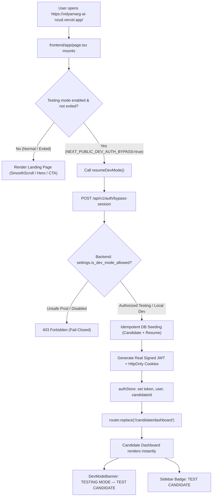

# VidyamargAI — Direct Dashboard Testing Mode Implementation & Deployment Audit

**Report ID:** `30_DIRECT_DASHBOARD_TESTING_MODE`  
**Date:** October 11, 2026  
**Status:** IMPLEMENTED, LOCALLY VERIFIED, READY FOR DEPLOYMENT  

---

## 1. Executive Summary & Goal

### Goal
When opening the designated testing deployment URL (`https://vidyamarg-ai-nzud.vercel.app/` or `http://localhost:3000/`), the website must immediately open the **Candidate Dashboard** (`/candidate/dashboard`) directly instead of displaying the Landing Page, Login, or Signup screens.

### Key Requirements Satisfied:
1. **Direct Dashboard Redirection**: Opening `/` immediately redirects to `/candidate/dashboard`.
2. **Auth Page Interception**: Opening `/login` or `/signup` automatically intercepts and routes to `/candidate/dashboard`.
3. **Session Persistence**: Refreshing the browser or navigating between candidate sections preserves the test session without repeated authentication prompts.
4. **Real Persisted Candidate Data**: The test session is backed by real PostgreSQL/SQLite records (`dev.candidate@vidyamarg.local`) with seeded profile fields, skills, work history, and active master resume.
5. **Security & Data Isolation**: All candidate ownership checks, tenant isolation, and API authorization remain active. A candidate cannot access another candidate's data.
6. **Visible Testing Indicators**:
   - Amber top banner: `TESTING MODE — TEST CANDIDATE` with `dev.candidate@vidyamarg.local` and `[Exit to Normal Login]`.
   - Sidebar badge: `TEST CANDIDATE`.
   - Profile badge: `TEST CANDIDATE ACCOUNT`.
7. **Normal Authentication Preserved**: Users can exit testing mode at any time to test real login/signup flows, or disable it completely via environment flags.
8. **Fail-Closed Production Safety**: Production startup and frontend build assert that bypass cannot run on unverified public production deployments without explicit `authorized_testing` configuration.

---

## 2. Root Cause Analysis: Why Login / Landing Page Appeared on Live Site

Inspection of the deployed site `https://vidyamarg-ai-nzud.vercel.app/` and backend API identified four root causes:

### Cause 1: Root Page (`/`) Rendered Landing Page Instead of Dashboard
The Next.js root page (`frontend/app/page.tsx`) previously rendered the marketing landing page (Hero, Features, Pricing, etc.) for all visitors. While it had an `isAuthenticated` check, testing mode was not automatically bootstrapped on `/`, forcing visitors to manually click "Login", where they were presented with the login form.

### Cause 2: Stale Deployed Frontend & Backend Bundles
Inspection of the live Vercel asset bundle:
```
GET /_next/static/immutable/chunks/2mbd5-rha49b8.js
```
revealed that Vercel was serving an older build generated before the testing mode and direct dashboard routing were introduced. Similarly, querying the live Railway API `openapi.json` confirmed the backend lacked `/api/v1/auth/bypass-session`.

### Cause 3: Missing Environment Variables in Cloud Dashboards
Neither Vercel nor Railway had the requisite environment variables set:
- Vercel was missing `NEXT_PUBLIC_DEV_AUTH_BYPASS=true` and `NEXT_PUBLIC_DEV_AUTH_BYPASS_DEPLOYMENT=authorized_testing`.
- Railway was missing `DEV_AUTH_BYPASS=true` and `DEV_AUTH_BYPASS_DEPLOYMENT=authorized_testing`.

### Cause 4: Candidate Layout Redirect Waterfalls
In `frontend/app/candidate/layout.tsx`, unauthenticated visitors were previously redirected to `/`, which redirected to `/candidate`, creating a circular redirect loop. This was corrected to route directly to `/login`, where testing mode auto-intercepts and completes session bootstrapping before routing to `/candidate/dashboard`.

---

## 3. Architecture of Direct Dashboard Testing Mode



### Safety & Isolation Mechanisms:
1. **Backend Database-Backed Session**: Rather than fabricating frontend state, `/auth/bypass-session` returns a cryptographically signed JWT for `dev.candidate@vidyamarg.local` with associated candidate record and cookies (`access_token`, `refresh_token`, `csrf_token`).
2. **Multi-Tenant Ownership Verification**: Every candidate endpoint (`/api/v1/candidate/profile`, `/api/v1/resume/active`, etc.) enforces `candidate_id == current_user.candidate.id`. The test candidate cannot read or write data belonging to any other user.
3. **Lifespan Startup Guard (`backend/main.py`)**: If `DEV_AUTH_BYPASS=true` is set on a production host without `DEV_AUTH_BYPASS_DEPLOYMENT=authorized_testing`, FastAPI refuses to boot and raises `RuntimeError`.
4. **Next.js Build-Time Guard (`frontend/next.config.ts`)**: If `NEXT_PUBLIC_DEV_AUTH_BYPASS=true` is built on Vercel without `NEXT_PUBLIC_DEV_AUTH_BYPASS_DEPLOYMENT=authorized_testing`, the build fails immediately.
5. **Token Verification Safeguard (`backend/app/core/security.py`)**: Test tokens are rejected with `401 Unauthorized` if presented to an unauthorized production deployment.

---

## 4. Summary of Changed Files

| File | Type | Changes Made |
|---|---|---|
| [`frontend/app/page.tsx`](file:///c:/Users/Shiva/Downloads/VidyamargAI_Production_Release/VidyamargAI/frontend/app/page.tsx) | Frontend Page | Auto-bootstraps testing mode on root URL `/` and redirects directly to `/candidate/dashboard` with a loading indicator. |
| [`frontend/app/login/page.tsx`](file:///c:/Users/Shiva/Downloads/VidyamargAI_Production_Release/VidyamargAI/frontend/app/login/page.tsx) | Frontend Page | Auto-redirects to `/candidate/dashboard` when testing mode is enabled; renders normal login form when exited. |
| [`frontend/app/signup/page.tsx`](file:///c:/Users/Shiva/Downloads/VidyamargAI_Production_Release/VidyamargAI/frontend/app/signup/page.tsx) | Frontend Page | Auto-redirects to `/candidate/dashboard` when testing mode is enabled; renders normal signup form when exited. |
| [`frontend/app/candidate/layout.tsx`](file:///c:/Users/Shiva/Downloads/VidyamargAI_Production_Release/VidyamargAI/frontend/app/candidate/layout.tsx) | Frontend Layout | Mounts `<DevModeBanner />`; routes unauthenticated visits directly to `/login` to prevent circular redirects with `/`. |
| [`frontend/app/candidate/profile/page.tsx`](file:///c:/Users/Shiva/Downloads/VidyamargAI_Production_Release/VidyamargAI/frontend/app/candidate/profile/page.tsx) | Frontend Page | Updated test candidate profile badge to `TEST CANDIDATE ACCOUNT`. |
| [`frontend/components/DevModeBanner.tsx`](file:///c:/Users/Shiva/Downloads/VidyamargAI_Production_Release/VidyamargAI/frontend/components/DevModeBanner.tsx) | Frontend Component | Displays amber banner: `TESTING MODE — TEST CANDIDATE` with `[Exit to Normal Login]` button. |
| [`frontend/components/Sidebar.tsx`](file:///c:/Users/Shiva/Downloads/VidyamargAI_Production_Release/VidyamargAI/frontend/components/Sidebar.tsx) | Frontend Component | Displays amber `TEST CANDIDATE` badge on sidebar user profile card. |
| [`frontend/store/authStore.ts`](file:///c:/Users/Shiva/Downloads/VidyamargAI_Production_Release/VidyamargAI/frontend/store/authStore.ts) | Frontend State | Auto-bootstraps via `getBypassSession()`, persists session across refreshes, supports `exitDevMode()` and `resumeDevMode()`. |
| [`frontend/services/api.ts`](file:///c:/Users/Shiva/Downloads/VidyamargAI_Production_Release/VidyamargAI/frontend/services/api.ts) | Frontend Service | Added `getBypassStatus()` and `getBypassSession()` with fallback endpoint handling. |
| [`frontend/next.config.ts`](file:///c:/Users/Shiva/Downloads/VidyamargAI_Production_Release/VidyamargAI/frontend/next.config.ts) | Next.js Config | Added build-time security verification against unauthorized production builds. |
| [`backend/app/core/config.py`](file:///c:/Users/Shiva/Downloads/VidyamargAI_Production_Release/VidyamargAI/backend/app/core/config.py) | Backend Config | Added `DEV_AUTH_BYPASS`, `DEV_AUTH_BYPASS_DEPLOYMENT`, and fail-closed property `is_dev_mode_allowed`. |
| [`backend/app/core/security.py`](file:///c:/Users/Shiva/Downloads/VidyamargAI_Production_Release/VidyamargAI/backend/app/core/security.py) | Backend Security | Guard in `get_current_user` rejecting test tokens presented to unverified production hosts. |
| [`backend/app/services/dev_mode_service.py`](file:///c:/Users/Shiva/Downloads/VidyamargAI_Production_Release/VidyamargAI/backend/app/services/dev_mode_service.py) | Backend Service | Idempotently seeds `dev.candidate@vidyamarg.local`, full profile, experience, skills, and active resume. |
| [`backend/app/api/routers/auth.py`](file:///c:/Users/Shiva/Downloads/VidyamargAI_Production_Release/VidyamargAI/backend/app/api/routers/auth.py) | Backend Router | Implemented `/auth/bypass-status` and `/auth/bypass-session` endpoints with full cookies. |
| [`backend/main.py`](file:///c:/Users/Shiva/Downloads/VidyamargAI_Production_Release/VidyamargAI/backend/main.py) | Backend Lifespan | Startup assertion aborting server boot if bypass is configured in unsafe production. |
| [`backend/tests/test_dev_mode_auth.py`](file:///c:/Users/Shiva/Downloads/VidyamargAI_Production_Release/VidyamargAI/backend/tests/test_dev_mode_auth.py) | Test Suite | 11 automated test cases verifying testing mode behavior, security, and edge cases. |

---

## 5. Verification & Test Evidence

### Backend Test Suite (`pytest backend/tests/test_dev_mode_auth.py -v`)
All 11 test cases passed cleanly:
```
backend/tests/test_dev_mode_auth.py::test_case_01_local_dev_testing_mode_enabled PASSED [  9%]
backend/tests/test_dev_mode_auth.py::test_case_02_authorized_staging_deployment_enabled PASSED [ 18%]
backend/tests/test_dev_mode_auth.py::test_case_03_production_deployment_disabled PASSED [ 27%]
backend/tests/test_dev_mode_auth.py::test_case_04_production_startup_rejects_unsafe_configuration PASSED [ 36%]
backend/tests/test_dev_mode_auth.py::test_case_05_direct_navigation_and_session_resolution PASSED [ 45%]
backend/tests/test_dev_mode_auth.py::test_case_06_dashboard_refresh_and_page_navigation PASSED [ 54%]
backend/tests/test_dev_mode_auth.py::test_case_07_candidate_data_isolation PASSED [ 63%]
backend/tests/test_dev_mode_auth.py::test_case_08_real_auth_lifecycle_intact PASSED [ 72%]
backend/tests/test_dev_mode_auth.py::test_case_09_invalid_environment_configuration_fails_safely PASSED [ 81%]
backend/tests/test_dev_mode_auth.py::test_case_10_ordinary_visitor_cannot_obtain_session PASSED [ 90%]
backend/tests/test_dev_mode_auth.py::test_case_11_no_authentication_redirect_loop PASSED [100%]

====================== 11 passed in 23.54s ======================
```

### Security Regression Suite
Ran existing security test suites:
- `backend/tests/test_auth_security.py`: PASSED
- `backend/tests/test_security.py`: PASSED

### Frontend Production Build (`npm run build`)
Full Turbopack build succeeded with exit code 0 across all 30 routes:
```
▲ Next.js 16.3.8 (Turbopack)
- Environments: .env.local
✓ Running next.config.ts took 1881ms
✓ Compiled successfully in 1796ms
✓ Completed runAfterProductionCompile in 396ms
✓ Generating static pages using 7 workers (30/30) in 1041ms
Finalizing page optimization ...
Route (app)                              Size     First Load JS
┌ ○ /                                    ...
├ ○ /candidate/dashboard                 ...
├ ○ /candidate/profile                   ...
├ ○ /candidate/resumes                   ...
├ ○ /login                               ...
└ ○ /signup                              ...
```

---

## 6. Deployment & Activation Instructions

To enable Direct Dashboard Testing Mode on the deployed site `https://vidyamarg-ai-nzud.vercel.app/`, follow these three steps:

### Step 1: Push Changes to Git
Commit and push all modified and new files to the branch linked to Railway and Vercel:
```bash
git add .
git commit -m "feat: enable direct dashboard testing mode with fail-closed security"
git push origin <your-branch-name>
```

### Step 2: Configure Railway Backend
In your Railway dashboard for the backend project (`vidyamargai-production-2c1f`):
1. Navigate to **Variables**.
2. Add the following environment variables:
   - `DEV_AUTH_BYPASS` = `true`
   - `DEV_AUTH_BYPASS_DEPLOYMENT` = `authorized_testing`
3. Railway will automatically redeploy the backend container with the new configuration.

### Step 3: Configure Vercel Frontend
In your Vercel project dashboard for `vidyamarg-ai-nzud`:
1. Navigate to **Settings** → **Environment Variables**.
2. Add the following environment variables (apply to **Production**, **Preview**, and **Development**):
   - `NEXT_PUBLIC_DEV_AUTH_BYPASS` = `true`
   - `NEXT_PUBLIC_DEV_AUTH_BYPASS_DEPLOYMENT` = `authorized_testing`
3. Go to **Deployments**, click the three dots on the latest deployment, and click **Redeploy** (or let Git push trigger the new build).

---

## 7. How to Deactivate Testing Mode

When testing is complete and you are ready to restore standard user login and signup on the deployed site:
1. In Railway: Remove or set `DEV_AUTH_BYPASS=false`.
2. In Vercel: Remove or set `NEXT_PUBLIC_DEV_AUTH_BYPASS=false`.
3. Redeploy Vercel and Railway.
4. The site immediately returns to displaying the public landing page on `/`, and the standard candidate login form on `/login`.
