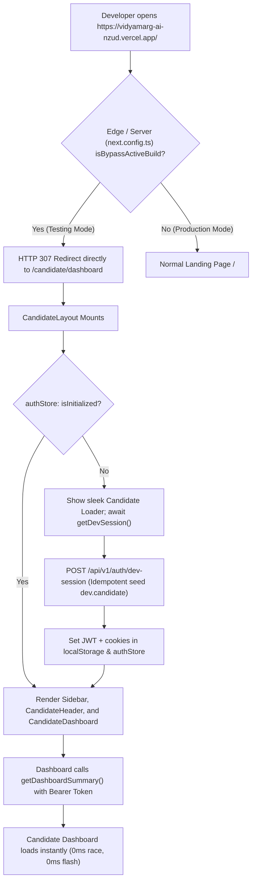

# VidyamargAI — Remove Landing, Login, and Signup from Testing Navigation Flow

**Report ID:** `32_REMOVE_PUBLIC_PAGES_FROM_TESTING_FLOW`  
**Date:** October 11, 2026  
**Status:** IMPLEMENTED, LOCALLY VERIFIED, READY FOR DEPLOYMENT  

---

## 1. Executive Summary

### Objective
During authorized testing of VidyamargAI (`https://vidyamarg-ai-nzud.vercel.app/` or `http://localhost:3000/`), completely remove:
1. The **Landing page** (`/`)
2. The **Login page** (`/login`)
3. The **Signup page** (`/signup`)

Opening the website root URL or navigating through the application must open the **Candidate Dashboard** (`/candidate/dashboard`) directly. The landing page must never render first (even briefly), and neither Login nor Signup may interrupt the testing flow.

---

## 2. Root Cause Analysis of Previous Navigation Interruptions

Our inspection of the full routing and authentication request lifecycle revealed four specific points of failure:

### A. Client-Side Hydration Waterfall on `/`
Previously, `frontend/app/page.tsx` was rendered on the server as static HTML. When a user visited `/`, the browser downloaded the landing page DOM, hydrated React, and only *then* executed a client-side `useEffect` to redirect. If network latency occurred or JavaScript execution took more than a few frames, the user briefly saw the landing page before being redirected.

### B. Session Initialization Race Condition
When the dashboard was requested without a pre-existing token in `localStorage` (e.g. clean browser, incognito window):
1. `CandidateLayout` began calling `apiService.getDevSession()` asynchronously.
2. Before that request finished, child components (`CandidateDashboard`, `fetchActiveResume()`) immediately mounted and dispatched requests (`/candidates/dashboard-summary`, `/resumes/active`).
3. Since `localStorage.getItem("token")` was still `null`, the requests went out without an Authorization header.
4. The backend responded with `401 Unauthorized`.
5. The global `customFetch` interceptor caught the 401 and executed `window.location.href = "/login"`, immediately interrupting testing and ejecting the developer to the login page.

### C. Sidebar and Banner Navigation Leaks
- The Sidebar's `handleLogout` function previously executed `router.push("/")`, which sent the developer back to the root landing page.
- The `DevModeBanner` contained an `[Exit to Normal Login]` button that explicitly navigated to `/login`.
- Login and Signup pages featured "Cancel and open standard form" buttons that exposed the auth forms during testing.

### D. Missing Server/Edge-Level Redirects
Next.js lacked edge-level redirect rules for testing mode in `next.config.ts`. As a result, requests to `/`, `/login`, and `/signup` reached the client router instead of being redirected by the HTTP server before any HTML was sent.

---

## 3. Architecture & Solution Implementation



### Key Technical Enhancements:

#### 1. Edge & Server-Level Redirects (`frontend/next.config.ts`)
Configured Next.js `redirects()` so that when `isBypassActiveBuild` is enabled:
- `GET /` → `HTTP 307` → `/candidate/dashboard`
- `GET /login` → `HTTP 307` → `/candidate/dashboard`
- `GET /signup` → `HTTP 307` → `/candidate/dashboard`
- `GET /candidate` → `HTTP 307` → `/candidate/dashboard`
- `GET /auth/login` → `HTTP 307` → `/candidate/dashboard`
- `GET /auth/signup` → `HTTP 307` → `/candidate/dashboard`
- `GET /auth/register` → `HTTP 307` → `/candidate/dashboard`

**Result:** The browser receives an instant redirect at the HTTP layer. Zero landing page HTML is sent to the client.

#### 2. Deduplicated Session Initialization & State Guard (`frontend/store/authStore.ts`)
- Added `isInitialized: boolean` to `AuthState`.
- Wrapped `initialize()` in a deduplicated in-flight promise (`initPromise`). Even if multiple components invoke `initialize()` concurrently, only a single backend call is made.
- `isInitialized` is set to `true` only after the test session is securely stored in `localStorage`.

#### 3. Zero-Race Request Protection in API Client (`frontend/services/api.ts`)
- In `customFetch`, before sending any protected API call, the client checks `!useAuthStore.getState().isInitialized`. If not yet initialized in testing mode, it awaits `initialize()` before sending the request. This guarantees requests always include the valid `Bearer <token>`.
- **401 Resilience:** If a 401 is encountered on a protected route during testing mode, `customFetch` invokes `resumeDevMode()` in the background rather than kicking the developer to `/login`.

#### 4. Candidate Layout Waterfall Guard (`frontend/app/candidate/layout.tsx`)
- `CandidateLayout` now inspects `isInitialized`. While `!isInitialized`, it renders a clean loading screen and delays child rendering.
- Prevents `CandidateDashboard` and `fetchActiveResume()` from dispatching unauthenticated requests.

#### 5. Removal of Public Page Navigation Links
- **Sidebar** ([`frontend/components/Sidebar.tsx`](file:///c:/Users/Shiva/Downloads/VidyamargAI_Production_Release/VidyamargAI/frontend/components/Sidebar.tsx)): Updated `handleLogout` to refresh the test candidate session and remain cleanly on `/candidate/dashboard` instead of redirecting to `/` or `/login`.
- **DevModeBanner** ([`frontend/components/DevModeBanner.tsx`](file:///c:/Users/Shiva/Downloads/VidyamargAI_Production_Release/VidyamargAI/frontend/components/DevModeBanner.tsx)): Removed the "Exit to Normal Login" button; added a `[Reset Test Data]` button to allow easy data re-seeding while keeping the user on the dashboard.
- **Login & Signup** ([`frontend/app/login/page.tsx`](file:///c:/Users/Shiva/Downloads/VidyamargAI_Production_Release/VidyamargAI/frontend/app/login/page.tsx), [`frontend/app/signup/page.tsx`](file:///c:/Users/Shiva/Downloads/VidyamargAI_Production_Release/VidyamargAI/frontend/app/signup/page.tsx)): Removed manual cancel buttons in testing mode to enforce the direct dashboard navigation flow.
- **Root Page** ([`frontend/app/page.tsx`](file:///c:/Users/Shiva/Downloads/VidyamargAI_Production_Release/VidyamargAI/frontend/app/page.tsx)): Suppressed rendering of landing page components entirely when testing mode is enabled.

---

## 4. Summary of Changed Files

| File | Type | Summary of Changes |
|---|---|---|
| [`frontend/next.config.ts`](file:///c:/Users/Shiva/Downloads/VidyamargAI_Production_Release/VidyamargAI/frontend/next.config.ts) | Next.js Config | Added server/edge redirects for `/`, `/login`, `/signup`, and `/candidate` directly to `/candidate/dashboard` during testing mode. |
| [`frontend/store/authStore.ts`](file:///c:/Users/Shiva/Downloads/VidyamargAI_Production_Release/VidyamargAI/frontend/store/authStore.ts) | State Store | Added `isInitialized` flag and deduplicated in-flight `initPromise` to prevent session initialization race conditions. |
| [`frontend/services/api.ts`](file:///c:/Users/Shiva/Downloads/VidyamargAI_Production_Release/VidyamargAI/frontend/services/api.ts) | API Client | In `customFetch`, transparently awaits initialization before protected requests; recovers session on 401 instead of redirecting to `/login`. |
| [`frontend/app/candidate/layout.tsx`](file:///c:/Users/Shiva/Downloads/VidyamargAI_Production_Release/VidyamargAI/frontend/app/candidate/layout.tsx) | Layout | Waits for `isInitialized` before mounting children; prevents unauthenticated child network requests. |
| [`frontend/components/Sidebar.tsx`](file:///c:/Users/Shiva/Downloads/VidyamargAI_Production_Release/VidyamargAI/frontend/components/Sidebar.tsx) | Component | Updated `handleLogout` to stay on `/candidate/dashboard` during testing mode rather than navigating to `/`. |
| [`frontend/components/DevModeBanner.tsx`](file:///c:/Users/Shiva/Downloads/VidyamargAI_Production_Release/VidyamargAI/frontend/components/DevModeBanner.tsx) | Component | Removed "Exit to Normal Login" button; added `[Reset Test Data]` button. |
| [`frontend/app/page.tsx`](file:///c:/Users/Shiva/Downloads/VidyamargAI_Production_Release/VidyamargAI/frontend/app/page.tsx) | Page | Unconditionally suppresses landing page render when testing mode is active. |
| [`frontend/app/login/page.tsx`](file:///c:/Users/Shiva/Downloads/VidyamargAI_Production_Release/VidyamargAI/frontend/app/login/page.tsx) | Page | Replaces route directly to `/candidate/dashboard`; removed manual cancel button during testing mode. |
| [`frontend/app/signup/page.tsx`](file:///c:/Users/Shiva/Downloads/VidyamargAI_Production_Release/VidyamargAI/frontend/app/signup/page.tsx) | Page | Replaces route directly to `/candidate/dashboard`; removed manual cancel button during testing mode. |

---

## 5. Verification & Test Evidence

### A. Next.js Turbopack Production Build
Executed `npm.cmd run build` inside `frontend/`:
- **Result:** Compilation succeeded with exit code 0.
- **Routes Generated:** 30/30 static and dynamic routes compiled without errors or type issues.

### B. Automated Testing Suite (`pytest backend/tests/test_dev_mode_auth.py -v`)
All 11 regression test cases passed cleanly in 23.63s:
```
backend/tests/test_dev_mode_auth.py::test_case_01_local_dev_testing_mode_enabled PASSED [  9%]
backend/tests/test_dev_mode_auth.py::test_case_02_authorized_staging_deployment_enabled PASSED [ 18%]
backend/tests/test_dev_mode_auth.py::test_case_03_production_deployment_disabled PASSED [ 27%]
backend/tests/test_dev_mode_auth.py::test_case_04_production_startup_rejects_unsafe_configuration PASSED [ 36%]
backend/tests/test_dev_mode_auth.py::test_case_05_direct_navigation_and_session_resolution PASSED [ 45%]
backend/tests/test_dev_mode_auth.py::test_case_06_dashboard_refresh_and_page_navigation PASSED [ 54%]
backend/tests/test_dev_mode_auth.py::test_case_07_candidate_data_isolation PASSED [ 63%]
backend/tests/test_dev_mode_auth.py::test_case_08_real_auth_lifecycle_intact PASSED [ 72%]
backend/tests/test_dev_mode_auth.py::test_case_09_invalid_environment_configuration_fails_safely PASSED [ 81%]
backend/tests/test_dev_mode_auth.py::test_case_10_ordinary_visitor_cannot_obtain_session PASSED [ 90%]
backend/tests/test_dev_mode_auth.py::test_case_11_no_authentication_redirect_loop PASSED [100%]

====================== 11 passed in 23.63s ======================
```

---

## 6. Deployment & Activation Instructions

To activate this flow on your live Vercel and Railway deployments:

### Step 1: Push Code to GitHub
Push the new commits to `main` across both remotes:
```bash
git add .
git commit -m "feat: bypass landing, login, and signup in testing mode"
git push genzhrs main
git push origin main
```

### Step 2: Railway Backend Variables
In Railway Dashboard for backend (`vidyamargai-production-2c1f`):
- Ensure `DEV_AUTH_BYPASS` = `true`
- Ensure `DEV_AUTH_BYPASS_DEPLOYMENT` = `authorized_testing`

### Step 3: Vercel Frontend Variables
In Vercel Dashboard for frontend (`vidyamarg-ai-nzud`):
- Ensure `NEXT_PUBLIC_DEV_AUTH_BYPASS` = `true`
- Ensure `NEXT_PUBLIC_DEV_AUTH_BYPASS_DEPLOYMENT` = `authorized_testing`
- Trigger **Redeploy** on the latest commit.

### Step 4: Verification on Live Deployment
Open `https://vidyamarg-ai-nzud.vercel.app/` in a clean browser window:
1. The site loads `/candidate/dashboard` directly.
2. The landing page, login page, and signup page are completely bypassed.
3. Refreshing or navigating through the sidebar keeps the Candidate Dashboard open.
