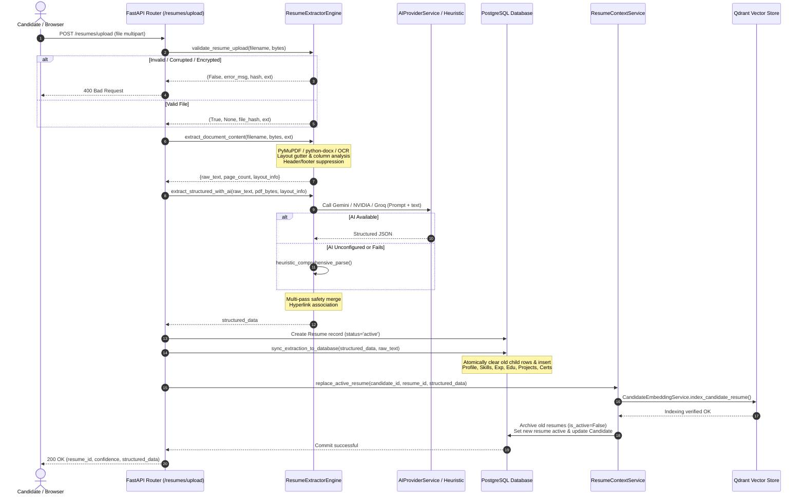

# VidyamargAI — Existing Resume Extraction Workflow Architecture

**Audit Document Version**: 1.0  
**Status**: Read-Only Architecture Inspection  
**Audit Date**: October 2026  
**Audited Subsystems**: `resume_extractor_engine.py`, `resume_center.py`, `resume_context_service.py`, `hyperlink_extractor.py`, `project_normalizer.py`, `latex_service.py`, `ats_optimizer.py`

---

## 1. Executive Overview

VidyamargAI features a multi-format, layout-aware resume extraction engine designed to ingest candidate resumes across diverse formats (PDF, DOCX, DOC, TXT, RTF, ODT, HTML, PPTX, TeX, PNG, JPG, TIFF). The architecture employs a hybrid extraction model:
1. **Low-level structural parsing** (PyMuPDF / python-docx / python-pptx) extracts text blocks, bounding boxes, spatial hyperlinks, and column geometry.
2. **Deterministic column & layout classification** resolves reading orders and suppresses running headers/footers.
3. **Hybrid AI & heuristic parsing** combines large language models (multimodal Gemini 1.5/2.0, NVIDIA NIM, Groq Llama 3) with a deterministic 2-pass heuristic engine.
4. **Relational normalization & entity deduplication** cleans dates, canonicalizes project structures, tokenizes joined technology stacks, and stores dual representations (raw JSON extraction + 8 normalized companion tables).
5. **Atomic active resume activation & vector indexing** ensures atomic switching of candidate profiles and updates Qdrant vector embeddings for semantic job matching.

```
       Candidate Resume Upload (PDF / DOCX / Images / Rich Text)
                                  │
                                  ▼
      ┌────────────────────────────────────────────────────────┐
      │ Stage 1: Upload Validation & Security Integrity Check  │
      │  - Size <= 10MB, Magic byte check, Zip bomb defense    │
      │  - PDF encryption check, SHA-256 fingerprinting        │
      └───────────────────────────┬────────────────────────────┘
                                  │
                                  ▼
      ┌────────────────────────────────────────────────────────┐
      │ Stage 2: Format-Specific Text & Spatial Extraction     │
      │  - PyMuPDF (fitz) with layout gutter detection         │
      │  - Word-level hyperlink intersection binding           │
      │  - Running header / footer suppression                │
      │  - python-docx body XML, tables, textboxes             │
      │  - OCR Fallback (PaddleOCR / PyMuPDF OCR)              │
      └───────────────────────────┬────────────────────────────┘
                                  │
                                  ▼
      ┌────────────────────────────────────────────────────────┐
      │ Stage 3: Section Heading Detection & Classification    │
      │  - Standard & unconventional heading regex patterns    │
      │  - Font size, bold weight, and all-caps classification │
      └───────────────────────────┬────────────────────────────┘
                                  │
                                  ▼
      ┌────────────────────────────────────────────────────────┐
      │ Stage 4: AI & Heuristic Structured Extraction          │
      │  - Multimodal Gemini / NVIDIA / Groq JSON parsing      │
      │  - 2-pass deterministic heuristic extraction fallback  │
      │  - Multi-pass safety merge (projects & companies)      │
      └───────────────────────────┬────────────────────────────┘
                                  │
                                  ▼
      ┌────────────────────────────────────────────────────────┐
      │ Stage 5: Normalization, Canonicalization & Deduplication│
      │  - Project schema canonicalization & bullet splitting  │
      │  - Technology stack tokenization & joined word split   │
      │  - Date parsing (ISO standardization)                  │
      └───────────────────────────┬────────────────────────────┘
                                  │
                                  ▼
      ┌────────────────────────────────────────────────────────┐
      │ Stage 6: Database Persistence & Versioning             │
      │  - Resume root record + ResumeExtraction (raw JSON)   │
      │  - 7 relational tables (Profile, Skills, Exp, Edu, etc)│
      │  - Initial ResumeVersion with LaTeX source             │
      └───────────────────────────┬────────────────────────────┘
                                  │
                                  ▼
      ┌────────────────────────────────────────────────────────┐
      │ Stage 7: Atomic Active Resume Activation & Downstream   │
      │  - ResumeDiffEngine comparison                         │
      │  - Qdrant Vector Store re-indexing                     │
      │  - Primary designation & target role synthesis         │
      │  - Candidate dashboard, ATS optimizer & job matching   │
      └────────────────────────────────────────────────────────┘
```

---

## 2. Complete Stage-by-Stage Workflow Trace

### Stage 1: Upload Validation & Security Integrity Check
- **Code Location**: `backend/app/services/resume_extractor_engine.py` (Lines 75–165: `validate_resume_upload`)
- **API Endpoint**: `POST /api/v1/resumes/upload` (`backend/app/api/routers/resume_center.py`, Lines 802–950)
- **Inputs**:
  - `filename`: String (e.g. `john_doe_resume.pdf`)
  - `content`: Raw binary bytes
  - `content_type`: String MIME type from HTTP header
- **Operations & Validation Checks**:
  1. **Empty File Check**: Rejects content with `len(content) == 0`.
  2. **File Size Boundary**: Rejects content exceeding `10 * 1024 * 1024` bytes (10 MB).
  3. **Extension Whitelist**: Permits 15 extensions: `.pdf`, `.docx`, `.doc`, `.txt`, `.rtf`, `.odt`, `.html`, `.htm`, `.pptx`, `.png`, `.jpg`, `.jpeg`, `.tiff`, `.tif`, `.tex`.
  4. **Magic Byte Fingerprinting**:
     - PDF: Checks `b"%PDF-"` at the head of the file.
     - DOCX / PPTX: Inspects standard ZIP header `b"PK\x03\x04"`, verifies presence of `[Content_Types].xml` and `word/` or `ppt/` internal directories.
     - Zip Bomb Protection: Checks compression ratio (`uncompressed_size / compressed_size < 100`) and limits maximum uncompressed size to 100 MB.
  5. **PDF Encryption Defense**: Opens document with `fitz.open(stream=content, filetype="pdf")` and tests `doc.is_encrypted or doc.needs_pass`. Returns clean rejection `"Password-protected or encrypted PDFs are not supported"`.
  6. **Integrity Fingerprint**: Generates deterministic SHA-256 hash (`hashlib.sha256(content).hexdigest()`) to detect identical re-uploads.
- **Output**: Tuple `(is_valid: bool, error_message: Optional[str], file_hash: str, normalized_ext: str)`.

---

### Stage 2: Format-Specific Text & Spatial Extraction
- **Code Location**: `backend/app/services/resume_extractor_engine.py` (Lines 170–265: `extract_document_content`)
- **Router Integration**: Line 849 in `resume_center.py`
- **Format Routing**:
  - `.pdf` ➔ `_extract_pdf_layout_aware(content)`
  - `.docx` ➔ `_extract_docx_with_tables(content)`
  - `.doc` ➔ `_extract_doc_legacy(content)` (antiword / soffice conversion)
  - `.rtf` ➔ `_extract_rtf_content(content)` (striprtf / regex)
  - `.odt` ➔ `_extract_odt_content(content)` (ZIP XML extraction)
  - `.html`, `.htm` ➔ `_extract_html_content(content)` (BeautifulSoup / lxml)
  - `.pptx` ➔ `_extract_pptx_content(content)` (python-pptx text runs)
  - `.png`, `.jpg`, `.jpeg`, `.tiff`, `.tif` ➔ `_extract_image_with_ocr(content)`
  - `.txt`, `.tex` ➔ Decodes UTF-8 with `latin-1` / `cp1252` fallback

#### PDF Extraction Details (`_extract_pdf_layout_aware`):
1. **PyMuPDF Extraction**: Opens PDF in memory via `fitz.open(stream=content, filetype="pdf")`.
2. **Spatial Hyperlink Extraction**: Calls `page.get_links()` for URIs and matches against `page.get_text("words")` bounding boxes to capture the anchor text underneath the link geometry.
3. **Running Header/Footer Suppression**:
   - Calculates page height `H`. Identifies blocks in the top 7% (`y1 < 0.07 * H`) and bottom 7% (`y0 > 0.93 * H`).
   - If identical or near-identical text occurs across >= 2 pages (e.g. `"John Doe | Page 2 of 3"`), it is suppressed from the content stream to prevent polluting experience and project sections.
4. **Multi-Column Geometry & Gutter Detection**:
   - Analyzes horizontal coordinates (`x0, x1`) of all text blocks on each page.
   - Sweeps a vertical gutter corridor from 25% to 75% of page width.
   - If a vertical gap exists where no text blocks cross, classifies layout as multi-column (`left_sidebar`, `right_sidebar`, or `equal_columns`).
   - Reads the columns sequentially (e.g. Left column from top to bottom, then Right column from top to bottom) instead of naive horizontal reading order, eliminating column interleaving.
5. **OCR Fallback Trigger**:
   - If a page contains `< 50` characters of extractable text, triggers `_attempt_ocr_on_page(page)`.
- **Output**: Dictionary:
  ```json
  {
    "raw_text": "Alex Mercer...",
    "page_count": 2,
    "layout_info": {
      "column_count": 2,
      "layout_type": "left_sidebar",
      "hyperlinks": [{"url": "https://github.com/alex", "anchor": "github.com/alex", "page": 1}]
    }
  }
  ```

---

### Stage 3: OCR Processing (Scanned Documents & Bitmaps)
- **Code Location**: `backend/app/services/resume_extractor_engine.py` (Lines 438–510: `_attempt_ocr_on_page`)
- **Libraries**: `PaddleOCR` (PP-OCRv4 / PP-OCRv6) and PyMuPDF Tesseract bindings (`page.get_textpage_ocr`).
- **Workflow**:
  1. Renders the page into a high-resolution pixmap at 200–300 DPI (`pix = page.get_pixmap(dpi=200)`).
  2. Converts pixmap samples into a NumPy uint8 RGB matrix.
  3. Passes matrix to `ocr.ocr(img_np)` or `ocr.predict(img_np)`.
  4. Collects detected text bounding boxes and sorts lines from top-to-bottom, left-to-right.
  5. If PaddleOCR throws an attribute error (e.g. PIR double-attribute issue under Windows CPU), falls back to PyMuPDF built-in OCR textpage.

---

### Stage 4: DOCX XML Parsing & Table Traversal
- **Code Location**: `backend/app/services/resume_extractor_engine.py` (Lines 515–620: `_extract_docx_with_tables`)
- **Libraries**: `python-docx`
- **Workflow**:
  1. Loads document stream via `docx.Document(io.BytesIO(content))`.
  2. Iterates across `document.element.body` preserving true document sequence:
     - For paragraphs (`w:p`): Extracts paragraph text and hyperlinks from `w:hyperlink` XML tags mapped against document relationship IDs.
     - For tables (`w:tbl`): Iterates rows and cells. Flattens cell text with pipe delimiter (` | `) to retain structural alignment.
     - For textboxes (`w:txbxContent`): Inspects floating text box shapes commonly used in modern resume templates for sidebars.

---

### Stage 5: Section Heading Detection & Classification
- **Code Location**: `backend/app/services/resume_extractor_engine.py` (Lines 625–780: `classify_heading_block`)
- **Heading Categories**:
  - `contact` / `personal_info`
  - `summary` / `objective` / `about`
  - `experience` / `employment` / `work history`
  - `education` / `academic background`
  - `skills` / `technical competencies`
  - `projects` / `technical initiatives`
  - `certifications` / `licenses`
  - `publications` / `research`
  - `awards` / `honors`
  - `languages`
  - `custom`
- **Detection Heuristics**:
  1. Matches against 150+ compiled regex patterns with word boundary markers.
  2. Evaluates typographic cues: text in all-caps, font size >= 11pt, bold font weight, standalone lines under 40 characters.
  3. Recognizes unconventional headings such as `"Where I've Worked"`, `"What I've Built"`, `"Code & Architecture"`.

---

### Stage 6: AI Structured Extraction & Heuristic Fallback
- **Code Location**: `backend/app/services/resume_extractor_engine.py` (Lines 1082–1215: `extract_structured_with_ai` and Lines 1220–1920: `heuristic_comprehensive_parse`)
- **Third-Party AI Services**: `app.services.ai_provider.ai_provider_service`
  - Priority 1: Gemini 1.5 / 2.0 Flash / Pro (supports native PDF multimodal bytes).
  - Priority 2: NVIDIA NIM (Llama 3 70B / Mixtral).
  - Priority 3: Groq Cloud API (Llama 3 70B fast inference).
- **Execution Workflow**:
  1. **Availability Check**: If no external AI API key is configured or all providers are unreachable, transparently executes `heuristic_comprehensive_parse(raw_text, layout_info)`.
  2. **Multimodal Gemini Path**: If PDF bytes are present and Gemini is configured, sends prompt + PDF binary.
  3. **Text Fallback Path**: If multimodal fails or non-PDF, passes text chunk (truncated to 14,000 characters) to chained text LLM endpoints.
  4. **Multi-Pass Safety Merge**:
     - Concurrently runs the deterministic heuristic parser.
     - Compares detected entities:
       - If heuristic extracted more projects than the LLM (`len(h_projs) > len(ai_projs)`), missing projects are merged into `parsed["projects"]`.
       - If heuristic extracted more employers than the LLM (`len(h_exps) > len(ai_exps)`), missing companies are merged into `parsed["work_experience"]`.
  5. **Hyperlink Binding**: Calls `associate_links_with_resume_entities(links, parsed)` from `app.services.hyperlink_extractor` to bind GitHub and live demo URLs to project and candidate profile records.

---

### Stage 7: Normalization, Canonicalization & Deduplication
- **Code Location**:
  - `backend/app/services/project_normalizer.py` (`canonicalize_project`, `canonicalize_projects_list`, `normalize_technologies_list`)
  - `backend/app/services/resume_extractor_engine.py` (Lines 1925–2150: `_normalize_and_validate_extraction`)
- **Operations**:
  1. **Project Canonicalization**: Normalizes disparate keys (`name` vs `title`, `bullets` vs `responsibilities`, `tech_stack` vs `technologies`).
  2. **Project Deduplication**: Detects duplicates based on normalized titles or Levenshtein similarity > 0.85; merges distinct bullets into a single master project entry.
  3. **Technology Stack Tokenization**:
     - Splits multi-term strings on commas, slashes, bullets, and pipes.
     - Splits concatenated CamelCase or glued strings (e.g. `FastAPIPythonPostgreSQL`) using regex word transitions and a dictionary of known tech terms.
  4. **Date Normalization**: Standardizes dates across formats (`"01/2020"`, `"Jan 2020"`, `"2020"`, `"Present"`) to standard year-month tuples.
  5. **Confidence Scoring**: Computes weighted completeness score (0.0–1.0) based on presence of name, email, phone, experience, education, and skills.

---

### Stage 8: Relational Database Storage & Persistence
- **Code Location**: `backend/app/api/routers/resume_center.py` (Lines 596–800: `sync_extraction_to_database`)
- **Database Models**: Defined in `backend/app/models/resume_center_models.py`
- **Tables Populated**:
  1. `resumes`: Root entity (file name, file hash, status, page count, confidence score, original storage URL).
  2. `resume_extractions`: Raw document text, layout geometry JSON, full structured JSON, missing fields list, parser warnings.
  3. `resume_profiles`: Personal information, phone numbers, emails, location, LinkedIn/GitHub URLs, professional summary.
  4. `resume_skills`: Granular skill rows classified by category (`programming_languages`, `frameworks`, `cloud_platforms`, `tools`, etc.).
  5. `resume_experiences`: Work history entries (employer, title, dates, responsibilities list, achievements list, metrics, technologies).
  6. `resume_educations`: Academic history (degree, institution, dates, grade/GPA, relevant coursework).
  7. `resume_projects`: Project records (name, description, tech stack, bullets, live links).
  8. `resume_certifications`: Professional licenses and certifications.
  9. `resume_sections`: Custom or unclassified sections.
  10. `resume_versions`: Initial version 1 snapshot containing LaTeX template payload.
- **Idempotency Guarantee**: Before inserting normalized rows for an existing resume, `sync_extraction_to_database` executes explicit `delete()` queries against child tables (`ResumeSkill`, `ResumeExperience`, `ResumeEducation`, `ResumeProject`, `ResumeCertification`, `ResumeSection`), completely preventing entity duplication upon re-parsing.

---

### Stage 9: Atomic Active Resume Activation & Qdrant Indexing
- **Code Location**: `backend/app/services/resume_context_service.py` (Lines 110–205: `replace_active_resume`)
- **Workflow**:
  1. **Diff Comparison**: `ResumeDiffEngine.compare_resumes` compares the newly uploaded resume structured data against the previously active resume.
  2. **Role & Designation Synthesis**: If a `MEANINGFUL_CHANGE` is detected, `RoleGeneratorService.generate_roles_from_resume` synthesizes:
     - `primary_designation` (e.g. "Senior Backend Distributed Systems Engineer")
     - `target_roles` (e.g. `["Cloud Architect", "Staff Platform Engineer"]`)
     - `role_evidence` (specific skills and years of experience justifying the role).
  3. **Vector Indexing & Verification**:
     - Connects to `QdrantVectorStore`.
     - Generates dense vector embeddings using `CandidateEmbeddingService`.
     - Inserts candidate profile vectors into Qdrant collection.
     - **Safety Guarantee**: If Qdrant indexing fails, the replacement pipeline aborts immediately; the previous active resume remains active.
  4. **Atomic Deactivation**:
     - Archives previous resumes (`is_active = False`, `status = "archived"`).
     - Activates newly uploaded resume (`is_active = True`, `status = "active"`, `candidate.active_resume_id = resume.id`).
  5. **Job Match Invalidation**: Invalidates stale pre-computed job recommendations in `candidate_job_matches` to trigger fresh recalculation based on new skills.

---

### Stage 10: LaTeX Compilation & Downstream Integrations
- **Code Location**:
  - `backend/app/services/latex_service.py` (`convert_to_template_payload`, `render_resume_to_latex`, `render_structured_data_to_pdf`)
  - `backend/app/services/ats_optimizer.py` (`run_full_jd_optimization`)
- **Operations**:
  1. **LaTeX Payload Mapping**: Maps normalized structured data into template-friendly dictionary matching Overleaf-compatible LaTeX templates (`classic-ats`, `modern-sidebar`, `executive`).
  2. **PDF Compilation**: Calls `pdflatex` / `xelatex` (or fallback ReportLab / WeasyPrint renderer) to produce a clean ATS-optimized vector PDF.
  3. **ATS Optimizer**: Consumes the structured extraction to compare against job descriptions, identifying missing keywords and suggesting impact-driven bullet rewrites.
  4. **Job Search & Recommendations**: Ingests `primary_designation`, `skills`, and target roles to rank live job listings.

---

## 3. Sequence Diagram



---

## 4. Component & Model Inventory

| Component / File | Primary Functions / Classes | Responsibilities | Dependencies |
| :--- | :--- | :--- | :--- |
| `backend/app/services/resume_extractor_engine.py` | `validate_resume_upload`, `extract_document_content`, `_extract_pdf_layout_aware`, `_attempt_ocr_on_page`, `extract_structured_with_ai`, `heuristic_comprehensive_parse`, `_normalize_and_validate_extraction` | Core extraction engine: file validation, layout analysis, OCR, AI extraction, heuristic parser. | PyMuPDF (`fitz`), `python-docx`, `python-pptx`, `PaddleOCR`, `PIL`, `pydantic` |
| `backend/app/services/hyperlink_extractor.py` | `extract_hyperlinks_from_pdf`, `associate_links_with_resume_entities` | Extracts bounding-box URLs from PDF annotations; maps GitHub/portfolio links to project records. | PyMuPDF |
| `backend/app/services/project_normalizer.py` | `canonicalize_project`, `canonicalize_projects_list`, `normalize_technologies_list` | Normalizes heterogeneous project schemas; deduplicates projects; tokenizes glued tech strings. | `re`, `difflib` |
| `backend/app/api/routers/resume_center.py` | `upload_resume_file`, `sync_extraction_to_database`, `convert_to_template_payload` | FastAPI endpoint for multi-format upload; database sync; LaTeX payload conversion. | FastAPI, SQLAlchemy, Pydantic |
| `backend/app/services/resume_context_service.py` | `ResumeContextService.replace_active_resume`, `get_active_resume` | Atomic replacement of candidate active resume; diff analysis; role generation trigger. | SQLAlchemy, Qdrant |
| `backend/app/services/ats_optimizer.py` | `run_full_jd_optimization`, `generate_optimized_docx` | ATS keyword scoring; gap analysis; zero-hallucination bullet point optimization. | `python-docx`, AI provider |
| `backend/app/services/latex_service.py` | `render_resume_to_latex`, `render_structured_data_to_pdf`, `compile_latex_to_pdf` | Maps structured data into LaTeX templates and compiles vector PDFs. | Jinja2, ReportLab, TeX Live |
| `backend/app/models/resume_center_models.py` | `Resume`, `ResumeExtraction`, `ResumeProfile`, `ResumeSkill`, `ResumeExperience`, `ResumeEducation`, `ResumeProject`, `ResumeCertification`, `ResumeSection`, `ResumeVersion` | Relational schema definitions representing the complete candidate resume lifecycle. | SQLAlchemy ORM |

---

## 5. Data Schemas

### 5.1 Raw Structured Extraction JSON Schema (`ResumeExtraction.structured_data`)
```json
{
  "personal_info": {
    "full_name": "String",
    "first_name": "String",
    "last_name": "String",
    "email": "String",
    "phone": "String",
    "location": "String",
    "city": "String",
    "state": "String",
    "country": "String",
    "linkedin_url": "String or null",
    "github_url": "String or null",
    "portfolio_url": "String or null"
  },
  "professional_summary": {
    "summary": "String",
    "career_objective": "String or null",
    "years_of_experience": "Number or null"
  },
  "work_experience": [
    {
      "employer": "String",
      "designation": "String",
      "employment_location": "String or null",
      "start_date": "String (e.g. '2021-03' or '2021')",
      "end_date": "String (e.g. 'Present' or '2023-11')",
      "is_current": "Boolean",
      "responsibilities": ["String"],
      "achievements": ["String"],
      "technologies": ["String"],
      "metrics": ["String"]
    }
  ],
  "education": [
    {
      "institution": "String",
      "degree": "String",
      "field_of_study": "String or null",
      "start_date": "String or null",
      "end_date": "String or null",
      "grade": "String or null",
      "relevant_coursework": ["String"]
    }
  ],
  "skills": {
    "programming_languages": ["String"],
    "frameworks_and_libraries": ["String"],
    "cloud_and_devops": ["String"],
    "databases": ["String"],
    "tools": ["String"],
    "all_raw_skills": ["String"]
  },
  "projects": [
    {
      "name": "String",
      "description": "String",
      "technologies": ["String"],
      "responsibilities": ["String"],
      "link": "String or null",
      "duration": "String or null"
    }
  ],
  "certifications": [
    {
      "name": "String",
      "issuing_organization": "String or null",
      "issue_date": "String or null"
    }
  ],
  "custom_sections": [
    {
      "section_title": "String",
      "original_content": "String"
    }
  ],
  "confidence_score": 0.95,
  "missing_fields": [],
  "extraction_warnings": []
}
```

### 5.2 Relational Entity Schema Mapping
```
Resume (id, candidate_id, title, file_name, file_hash, page_count, status, is_active)
  ├── 1:1 ── ResumeExtraction (raw_text, layout_info, structured_data, confidence_score)
  ├── 1:1 ── ResumeProfile (full_name, email, phone, location, linkedin_url, github_url)
  ├── 1:N ── ResumeSkill (name, category, source_text)
  ├── 1:N ── ResumeExperience (employer, designation, start_date, end_date, responsibilities)
  ├── 1:N ── ResumeEducation (degree, institution, field_of_study, graduation_year, grade)
  ├── 1:N ── ResumeProject (name, description, technologies, responsibilities, link)
  ├── 1:N ── ResumeCertification (name, issuing_organization, issue_date)
  ├── 1:N ── ResumeSection (section_title, original_content, section_category)
  └── 1:N ── ResumeVersion (version_number, structured_data, latex_source)
```
