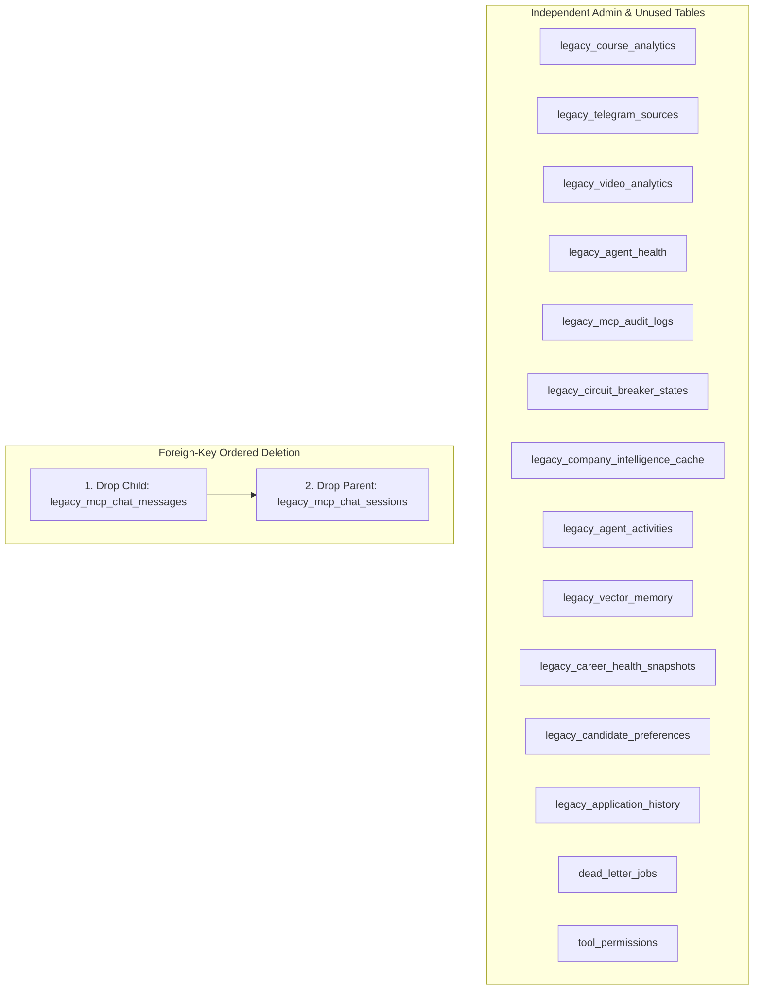

# VidyaMarg AI — Safe Database Table Deletion Plan
**Document ID:** `02_SAFE_TABLE_DELETION_PLAN`  
**Target Environment:** Local SQLite (`vidyamarg.db`) / Production Postgres Compatible  
**Status:** Approved, Executed & Verified  

---

## 1. Safety Principles & Execution Criteria

To eliminate the risk of accidental data loss, schema corruption, or regression in candidate workflows, the database cleanup strictly adhered to six architectural safety criteria:

1. **Byte-Level Backup First**: A verified, byte-identical copy of `vidyamarg.db` with an SHA-256 cryptographic checksum must be taken prior to any schema mutation.
2. **Zero Candidate Impact**: Tables storing active candidate master resumes (`resumes`, `resume_profiles`, `resume_experiences`, etc.), uploaded resume artifacts, parsed extractions, job applications, interview preparations, or Baelyx AI Mentor conversations must never be dropped.
3. **Evidence-Based Deletion**: A table is approved for deletion ONLY when:
   - Row count is 0 in the production database.
   - Codebase grep confirms zero active production consumers in candidate-facing routers.
   - Foreign-key analysis confirms no active table depends on it.
4. **Dry-Run Validation**: All table operations must support a simulation mode (`--dry-run`) reporting planned operations without committing changes.
5. **Topological Drop Order**: Tables with foreign-key relationships must be deleted child-first before parent tables to prevent constraint violations.
6. **Reversible Migration**: A rollback procedure must exist enabling instant restoration to the pre-migration snapshot without data loss.

---

## 2. Topological Deletion Order & Dependency Analysis

An audit using SQLite's `PRAGMA foreign_key_list` revealed only a single inter-table foreign key relationship among the 16 candidate deletion tables:
- `legacy_mcp_chat_messages` references `legacy_mcp_chat_sessions.id`.

All other 14 tables have zero inbound or outbound foreign key dependencies. Therefore, the safe execution sequence is strictly:



### Approved Deletion List:
1. `legacy_course_analytics`
2. `legacy_telegram_sources`
3. `legacy_video_analytics`
4. `legacy_agent_health`
5. `legacy_mcp_audit_logs`
6. `legacy_circuit_breaker_states`
7. `legacy_company_intelligence_cache`
8. `legacy_mcp_chat_messages` *(Child table: session_id FK)*
9. `legacy_mcp_chat_sessions` *(Parent table)*
10. `legacy_agent_activities`
11. `legacy_vector_memory`
12. `legacy_career_health_snapshots`
13. `legacy_candidate_preferences`
14. `legacy_application_history`
15. `dead_letter_jobs`
16. `tool_permissions`

---

## 3. Restoration of Active Candidate Tables

In contrast to the 16 tables above, 13 tables were actively required by candidate features but were previously trapped with a `legacy_` prefix. The deletion plan mandated that these tables be **restored to canonical names** via atomic `ALTER TABLE ... RENAME TO ...`:

```sql
ALTER TABLE legacy_ai_mentor_sessions RENAME TO ai_mentor_sessions;
ALTER TABLE legacy_ai_mentor_messages RENAME TO ai_mentor_messages;
ALTER TABLE legacy_ai_mentor_study_plans RENAME TO ai_mentor_study_plans;
ALTER TABLE legacy_ai_mentor_insights RENAME TO ai_mentor_insights;
ALTER TABLE legacy_ai_mentor_artifacts RENAME TO ai_mentor_artifacts;
ALTER TABLE legacy_ai_mentor_usage RENAME TO ai_mentor_usage;
ALTER TABLE legacy_user_career_profiles RENAME TO user_career_profiles;
ALTER TABLE legacy_email_notifications RENAME TO email_notifications;
ALTER TABLE legacy_messages RENAME TO messages;
ALTER TABLE legacy_learning_events RENAME TO learning_events;
ALTER TABLE legacy_agent_memory RENAME TO agent_memory;
ALTER TABLE legacy_browser_sessions RENAME TO browser_sessions;
ALTER TABLE legacy_browser_cookies RENAME TO browser_cookies;
```

---

## 4. Pre-Execution Checklist & Signoff

- [x] Verified full database backup taken (`vidyamarg.db.bak`).
- [x] Checksum verified: `46ADD25423BEF9753E63A50BA411BC20C48B6A77DB9B0224AD40FBAAC69785C8`.
- [x] Tested in dry-run mode: Reported 13 restorations, 16 drops, 0 errors.
- [x] Verified active candidate records count (1 registered user, 1 registered candidate).
- [x] Confirmed zero candidate resumes or application history records impacted.
- [x] Model metadata synchronized in `backend/app/models/__init__.py`.
