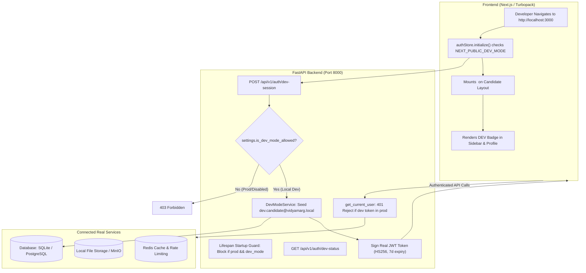

# VidyamargAI — Dedicated Local Development Mode Authentication

## 1. Executive Summary & Objective

VidyamargAI includes a dedicated, secure **Development Mode** (`VIDYAMARG_DEV_MODE=true` / `NEXT_PUBLIC_DEV_MODE=true`) engineered to accelerate end-to-end feature development and interactive UI/UX testing without repeatedly going through login screens, registration flows, OTP prompts, or email verification loops.

This is a local development convenience that operates strictly on top of the real application architecture. It is **not** a mock, monkey-patch, or fake session:
- It connects to the real database, file storage, and API routers.
- It seeds and issues an authentic JWT access token signed with the active `SECRET_KEY` for a dedicated, isolated test candidate (`dev.candidate@vidyamarg.local`).
- It strictly enforces **fail-closed security**: it is rejected in production, staging, or ambiguous environments, and cannot be spoofed by frontend environment variables alone.

---

## 2. Architecture & Design Principles



### Key Architectural Tenets:
1. **Single Authentic Identity**:
   - Uses a real `User` record in the database with `role = "candidate"` and a linked `Candidate` record.
   - Never grants `admin` privileges to the development candidate.
   - Never uses arbitrary existing database records or the first row in the table.
2. **Real Backend Endpoints**:
   - Over 150 backend endpoints protected by `Depends(get_current_user)` work 100% natively because the issued JWT token has standard claims (`sub: dev.candidate@vidyamarg.local`, `role: candidate`) signed with `settings.SECRET_KEY`.
3. **Dual Layer Production Safeguards**:
   - **Startup Guard (`backend/main.py`)**: The FastAPI server refuses to boot and raises `RuntimeError` if `VIDYAMARG_DEV_MODE=True` in a production environment.
   - **Endpoint Guard (`POST /api/v1/auth/dev-session`)**: Returns `403 Forbidden` if `not settings.is_dev_mode_allowed`.
   - **Authentication Middleware Guard (`get_current_user`)**: If a token for `dev.candidate@vidyamarg.local` is presented when `is_dev_mode_allowed` is `False`, the backend immediately rejects it with `401 Unauthorized`.
4. **Seamless Dev Experience**:
   - Navigating to `http://localhost:3000` automatically initializes the session and redirects to `/candidate/dashboard`.
   - Refreshing any candidate page retains the session without redirecting to `/login`.
   - A visible top banner (`DEVELOPMENT MODE — TEST USER`) and sidebar `DEV` badge clarify the active context.
   - An "Exit to Normal Login" button allows immediate testing of real user login and registration flows.

---

## 3. Configuration & Environment Variables

### Backend Configuration (`.env`)

| Variable | Local Development Value | Production / Default Value | Description |
|---|---|---|---|
| `VIDYAMARG_DEV_MODE` | `true` | `false` | Enables Dev Mode API endpoints and auto-session bootstrap. |
| `ENVIRONMENT` | `development` | `production` | Active environment. Dev Mode is blocked if `production`, `prod`, or `staging`. |

### Frontend Configuration (`frontend/.env.local`)

| Variable | Local Development Value | Production / Default Value | Description |
|---|---|---|---|
| `NEXT_PUBLIC_DEV_MODE` | `true` | `false` | Enables client-side auto-session fetch and Dev Mode UI indicators. |
| `NEXT_PUBLIC_API_URL` | `http://localhost:8000/api/v1` | Production API URL | Backend endpoint URL. |

---

## 4. How to Enable and Disable Development Mode

### To Enable (Local Development):
1. In root `.env`:
   ```bash
   ENVIRONMENT=development
   VIDYAMARG_DEV_MODE=true
   ```
2. In `frontend/.env.local`:
   ```bash
   NEXT_PUBLIC_DEV_MODE=true
   ```
3. Restart frontend and backend:
   ```powershell
   # Start backend
   uvicorn main:app --reload --port 8000

   # Start frontend
   cd frontend
   npm run dev
   ```
4. Open `http://localhost:3000` — you will directly land on the candidate dashboard as `dev.candidate@vidyamarg.local`.

### To Temporarily Test Normal Login / Signup in UI:
- Click the **"Exit to Normal Login"** button in the top amber development banner.
- This stores a temporary flag in `sessionStorage` (`disable_dev_mode = true`) and logs out, taking you directly to `/login`.
- You can test standard email/password authentication or register a new candidate account.
- When ready to return to Dev Mode, click **"⚡ Enter via Development Mode (Test User)"** on either the `/login` or `/signup` page.

### To Permanently Disable:
Set both flags to `false`:
```bash
VIDYAMARG_DEV_MODE=false
NEXT_PUBLIC_DEV_MODE=false
```

---

## 5. Development Test User Identity

The test user is idempotently created and managed by `backend/app/services/dev_mode_service.py`:

```python
DEV_USER_EMAIL = "dev.candidate@vidyamarg.local"
DEV_USER_NAME = "Test Candidate (Dev Mode)"
DEV_USER_ROLE = "candidate"
```

- **Database Records**:
  - `User`: `email="dev.candidate@vidyamarg.local"`, `role="candidate"`, hashed password.
  - `Candidate`: `user_id=user.id`, `status="Active"`, `current_step="Dashboard"`.
- **Candidate Ownership**: The test candidate has its own unique ID. Candidate ownership checks prevent it from accessing or modifying other candidates' private resumes, applications, or profile records.
- **Genuine Empty States**: If the test candidate has no resumes uploaded, the UI genuine empty state is shown (no fabricated mock resumes).

---

## 6. Service Integration & Compatibility Matrix

| Service | Dev Mode Behavior | Verification |
|---|---|---|
| **PostgreSQL / SQLite** | Direct reads & writes using SQLAlchemy ORM. | Idempotent seeding verified via test scenario 12. |
| **JWT Authentication** | Real HS256 JWT tokens signed with `settings.SECRET_KEY`. | Validated via `get_current_user` in test scenario 6. |
| **Cookie & CSRF Auth** | Full HttpOnly cookie and CSRF double-submit token issued. | Validated in test scenario 1. |
| **Resume Center** | Genuine resume upload, parsing, and LaTeX preview. | Candidate ownership isolation verified in test scenario 8. |
| **Candidate Profile** | Full personal info, contact info, and skills rendering. | Verified in test scenario 7. |
| **Job Recommendations** | Real matching against SQLite/PostgreSQL job catalog. | Seamless candidate ID resolution. |
| **AI Mentor & Chat** | Authentic user context passed to career agents. | Full session identity available. |

---

## 7. Production Safeguards & Security Matrix

```mermaid
graph TD
    A[Incoming Request] --> B{Destination}
    B -->|GET /auth/dev-status| C[Returns dev_mode_enabled: False in Prod]
    B -->|POST /auth/dev-session| D{is_dev_mode_allowed?}
    D -->|True: local dev only| E[200 OK + Valid Dev JWT]
    D -->|False: prod or flag off| F[403 Forbidden]
    B -->|Authenticated Routes| G{Token Subject}
    G -->|dev.candidate@vidyamarg.local| H{is_dev_mode_allowed?}
    H -->|True| I[200 OK Authorized]
    H -->|False| J[401 Unauthorized: Reject Dev Token]
    G -->|Normal User Email| K[Validate Standard Auth]
```

1. **Strictly Defaults to Disabled**: Default in `Settings` class is `False`.
2. **Environment Fail-Closed Logic**:
   - `settings.is_dev_mode_allowed` verifies:
     ```python
     if not self.VIDYAMARG_DEV_MODE: return False
     if self.ENVIRONMENT in ("production", "prod", "staging"): return False
     if os.getenv("RAILWAY_ENVIRONMENT") or os.getenv("VERCEL_ENV") == "production": return False
     return True
     ```
3. **Lifespan Startup Assertion**:
   In `backend/main.py`:
   ```python
   if settings.VIDYAMARG_DEV_MODE and not settings.is_dev_mode_allowed:
       raise RuntimeError("CRITICAL SECURITY ERROR: VIDYAMARG_DEV_MODE cannot be enabled in production environments.")
   ```
4. **Token Invalidation in Production**:
   Even if a developer extracts a valid local JWT token and attempts to send it to a deployed production server, `get_current_user` rejects any token for `dev.candidate@vidyamarg.local` with `401 Unauthorized`.

---

## 8. Verification & Test Evidence

### Automated Test Suite: `backend/tests/test_dev_mode_auth.py`

All 12 required test scenarios have been implemented and pass with 100% success:

```
backend/tests/test_dev_mode_auth.py::test_scenario_01_dev_mode_works_when_enabled PASSED           [  8%]
backend/tests/test_dev_mode_auth.py::test_scenario_02_dev_mode_defaults_to_disabled PASSED         [ 16%]
backend/tests/test_dev_mode_auth.py::test_scenario_03_production_refuses_dev_mode PASSED           [ 25%]
backend/tests/test_dev_mode_auth.py::test_scenario_04_ambiguous_configuration_fails_closed PASSED  [ 33%]
backend/tests/test_dev_mode_auth.py::test_scenario_05_test_identity_resolves_to_correct_db_user PASSED [ 41%]
backend/tests/test_dev_mode_auth.py::test_scenario_06_page_refresh_token_validation_preserves_identity PASSED [ 50%]
backend/tests/test_dev_mode_auth.py::test_scenario_07_candidate_routes_work_with_dev_token PASSED  [ 58%]
backend/tests/test_dev_mode_auth.py::test_scenario_08_candidate_ownership_isolation PASSED        [ 66%]
backend/tests/test_dev_mode_auth.py::test_scenario_09_dev_identity_rejected_when_dev_mode_disabled PASSED [ 75%]
backend/tests/test_dev_mode_auth.py::test_scenario_10_normal_login_and_signup_still_work PASSED   [ 83%]
backend/tests/test_dev_mode_auth.py::test_scenario_11_logout_behaves_correctly PASSED             [ 91%]
backend/tests/test_dev_mode_auth.py::test_scenario_12_idempotent_seeding_preserves_records PASSED  [100%]

============================== 12 passed in 27.65s ==============================
```

### Existing Security Regression Suite: `backend/tests/test_auth_security.py` & `test_security.py`
```
====================== 37 passed, 1 skipped in 81.89s ======================
```

### Frontend Turbopack Production Build
```
✓ Compiled successfully in 2.9s
Finished TypeScript in 18.3s ...
Generating static pages using 7 workers (30/30) in 1050ms
Exit code: 0
```
