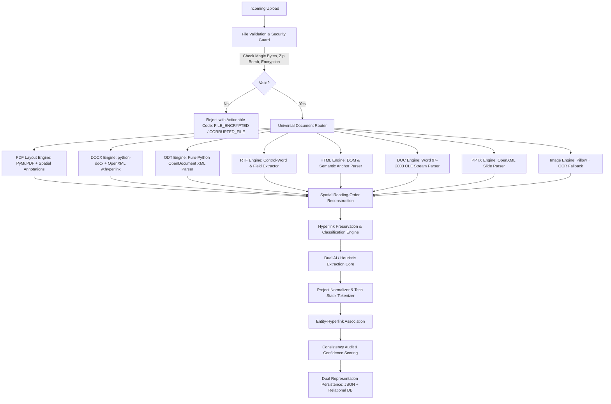

# Universal Resume Extraction Engine — System Architecture

**Document Version**: 2.0.0  
**Status**: Production Ready  
**Component**: `VidyaMarg AI Resume Intelligence Core`  
**Authors**: Principal AI/ML Engineer, Document Intelligence Architect, Full-Stack Team

---

## 1. Executive Summary & Architectural Vision

The VidyaMarg AI Universal Resume Extraction & Parsing Engine is an enterprise-grade document intelligence platform designed to ingest resumes across 15 file formats and arbitrary structural templates with zero hallucination, strict reading-order preservation, and first-class hyperlink extraction.

Historically, resume parsing systems have suffered from three systemic vulnerabilities:
1. **Layout Blindness**: Multi-column documents, sidebars, and callout boxes had their text flattened linearly, causing sidebar technical skills to be interspersed directly into chronological work experience descriptions.
2. **Hyperlink Degradation**: Clickable hyperlinks (such as GitHub project repositories, live Vercel deployments, portfolio sites, and LinkedIn profiles) were lost during text flattening, stripping critical verifiable evidence from candidate profiles.
3. **Format Fragility**: Binary Word documents (`.doc`), OpenDocument Text (`.odt`), rich text (`.rtf`), and presentation decks (`.pptx`) failed to ingest or caused server exceptions without actionable user feedback.

The VidyaMarg AI Universal Engine resolves these limitations through a modular, layout-aware pipeline:

---

## 2. Ingestion Pipeline Stages

### Stage 1: Validation, Integrity Hashing & Security Verification
- **Magic Byte Verification**: Verifies binary headers against declared extensions (`%PDF-`, `PK\x03\x04`, `\xd0\xcf\x11\xe0`, `{\rtf`, image signatures). Disguised executables or renamed invalid files are rejected before processing.
- **Encryption & Password Detection**: Detects password-protected PDFs via `fitz.Document.is_encrypted` and `needs_pass`. Instead of unhandled 500 errors, returns HTTP 400 with actionable error code `FILE_ENCRYPTED` requesting password removal.
- **Decompression Bomb Protection**: Inspects zip-based archives (`.docx`, `.odt`, `.pptx`) with strict uncompressed byte thresholds (< 50MB) and compression ratio caps (< 100:1).
- **Integrity Fingerprinting**: Generates SHA-256 cryptographic hashes for idempotent duplicate detection.

### Stage 2: Format Routing & Layout Extraction
- Universal routing forwards content bytes to format-specialized handlers.
- Multi-page and multi-column geometries are analyzed per page.
- Text boxes, table cells, running headers, and footers are recovered without dropping nested nodes.

### Stage 3: Geometry-Based Reading Order Reconstruction
- PyMuPDF blocks `(x0, y0, x1, y1, text, block_no, block_type)` are segmented into:
  - **Header Banner**: Spanning top elements containing candidate identity and contact info.
  - **Left Sidebar**: `x1 <= width * 0.45` sorted top-to-bottom.
  - **Main Content**: `x0 >= width * 0.35` sorted top-to-bottom.
  - **Footer Banner**: Bottom margin elements.
- Reconstructed order guarantees that skills in a sidebar are parsed as a cohesive section before work experience begins.

### Stage 4: First-Class Hyperlink Extraction & Semantic Classification
- Visible text labels are spatial-clipped from PDF annotation rectangles or recovered from OpenXML/HTML tags.
- Links are validated, normalized, and classified into semantic categories (`linkedin`, `github`, `portfolio`, `project_repo`, `project_demo`, `credential`, `email`, `phone`, `other`).
- Discovered URLs are attached to candidate profiles, project entries, and certifications.

### Stage 5: Dual Extraction Engine (AI Structured + Deterministic Heuristic)
- **Primary**: Structured prompt invocation with schema adherence, zero hallucination constraints, and multi-pass safety merging.
- **Secondary (Zero Downtime)**: Deterministic 2-pass structural parser that operates offline without API keys, ensuring platform availability under network or quota disruptions.

### Stage 6: Project Canonicalization & Technology Tokenization
- Integrates `app.services.project_normalizer` to eliminate redundant bullet points and prevent description duplication.
- Deconstructs jammed technology strings (e.g., `FastAPIPythonPostgreSQLAzure OCRNERGemini LLM`) into discrete canonical tokens.

### Stage 7: Dual Representation Persistence
- Stores full structured extraction and metadata in `ResumeExtraction`.
- Populates relational companion models (`ResumeProfile`, `ResumeSkill`, `ResumeExperience`, `ResumeEducation`, `ResumeProject`, `ResumeCertification`, `ResumeSection`) for SQL querying and Overleaf LaTeX compilation.
