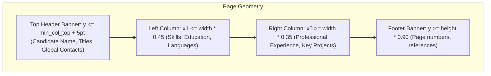

# Canonical Resume Schema, Reading-Order Geometry & Dual Representation

**Document Version**: 2.0.0  
**Status**: Production Verified  
**Schema Definition**: `app/models/resume_center_models.py` & `app/services/resume_extractor_engine.py`

---

## 1. Overview & Dual Representation Pattern

VidyaMarg AI uses a **Dual Representation Pattern** for resume data:

1. **Document-Level Representation (`ResumeExtraction`)**: Complete, lossless JSON document containing raw text, full layout geometry, confidence metrics, missing field lists, warnings, and first-class hyperlink records.
2. **Relational Representation (Normalized SQL Tables)**: Strongly typed database tables (`ResumeProfile`, `ResumeSkill`, `ResumeExperience`, `ResumeEducation`, `ResumeProject`, `ResumeCertification`, `ResumeSection`) supporting structured SQL queries, relational filtering, and Overleaf LaTeX compilation.

---

## 2. Reading-Order Geometry Reconstruction

In multi-column resume layouts (e.g., standard two-column formats with a 30% left sidebar for skills and contact info, and a 70% main body for experience and projects), standard text extraction concatenates text blocks by baseline $y$-coordinate. This results in the sidebar skills being interleaved directly into the work experience descriptions.

The VidyaMarg AI engine implements **geometric spatial partitioning**:



### Partitioning Rules:
1. **Column Candidate Detection**:
   - `col_left = [b for b in blocks if b[2] <= page_width * 0.45]`
   - `col_right = [b for b in blocks if b[0] >= page_width * 0.35]`
   - Layout is classified as multi-column if `len(col_left) >= 2` and `len(col_right) >= 2`.
2. **Top Header Isolation**:
   - `min_col_top = min(min(b[1] for b in col_left), min(b[1] for b in col_right))`
   - Any block whose bottom edge satisfies `b[3] <= min_col_top + 5` is designated as part of the Header Banner.
3. **Sequential Section Reassembly**:
   - `ordered_blocks = header_blocks + left_blocks + middle_blocks + right_blocks + footer_blocks`
   - Reconstructed text ensures that skills in the left sidebar are extracted contiguously before the main work experience begins.

---

## 3. Canonical JSON Schema Specification

The full extraction JSON schema is structured as follows:

```json
{
  "personal_info": {
    "full_name": "Maya Lin",
    "first_name": "Maya",
    "middle_name": null,
    "last_name": "Lin",
    "professional_title": "Lead Architect",
    "email": "maya.lin@cloudarch.dev",
    "additional_emails": [],
    "phone": "+1 555-0199",
    "additional_phones": [],
    "location": "Austin, TX",
    "city": "Austin",
    "state": "TX",
    "country": "United States",
    "linkedin_url": "https://linkedin.com/in/mayalin",
    "github_url": "https://github.com/mayalin",
    "portfolio_url": "https://mayalin.cloud",
    "custom_links": []
  },
  "professional_summary": {
    "summary": "Accomplished Distributed Systems Architect with 10+ years designing fault-tolerant platforms.",
    "career_objective": null,
    "years_of_experience": 10.0,
    "areas_of_specialization": ["Cloud Architecture", "Distributed Systems"],
    "career_interests": []
  },
  "skills": {
    "programming_languages": ["Python", "Go", "Rust", "SQL"],
    "frameworks_libraries": ["FastAPI", "React", "PyTorch"],
    "databases": ["PostgreSQL", "Redis", "Cassandra"],
    "cloud_platforms": ["Kubernetes", "AWS", "Docker", "Terraform"],
    "developer_tools": ["Git", "Postman", "CI/CD"],
    "ai_ml_technologies": [],
    "soft_skills": ["Technical Leadership", "System Design"],
    "domain_knowledge": ["High Availability", "Microservices"],
    "other_skills": [],
    "all_raw_skills": ["Python", "Go", "Rust", "SQL", "FastAPI", "React", "PostgreSQL", "Kubernetes", "AWS"]
  },
  "work_experience": [
    {
      "employer": "CloudOps Inc",
      "company": "CloudOps Inc",
      "designation": "Principal Systems Architect",
      "role": "Principal Systems Architect",
      "employment_location": "Austin, TX",
      "start_date": "Jan 2021",
      "end_date": "Present",
      "is_current": true,
      "employment_type": "Full-time",
      "responsibilities": [
        "Architected multi-region Kubernetes platform handling 20M daily requests.",
        "Reduced multi-cloud infrastructure expenditure by 42% via automated right-sizing."
      ],
      "achievements": [
        "Awarded Engineering MVP for 99.999% platform reliability during peak Black Friday."
      ],
      "technologies": ["Kubernetes", "Go", "Terraform", "AWS"],
      "metrics": ["20M daily requests", "42% cost reduction"]
    }
  ],
  "education": [
    {
      "degree": "Bachelor of Science in Computer Science",
      "field_of_study": "Computer Science",
      "institution": "University of Texas at Austin",
      "location": "Austin, TX",
      "start_date": "2012",
      "end_date": "2016",
      "graduation_year": "2016",
      "grade": "3.85/4.0",
      "relevant_coursework": ["Distributed Systems", "Operating Systems", "Algorithms"],
      "achievements": [],
      "thesis": null
    }
  ],
  "projects": [
    {
      "name": "High-Throughput Distributed Cache",
      "duration": "2023",
      "start_date": "2023",
      "end_date": "2023",
      "technologies": ["Rust", "Raft", "Tokio"],
      "tech_stack": "Rust, Raft, Tokio",
      "description": "High-performance distributed key-value store using Raft consensus.",
      "bullets": [
        "Implemented Raft consensus in Rust with sub-millisecond replication latency.",
        "Benchmarked throughput at 150k read/write operations per second."
      ],
      "responsibilities": [
        "Implemented Raft consensus in Rust with sub-millisecond replication latency.",
        "Benchmarked throughput at 150k read/write operations per second."
      ],
      "features": [],
      "link": "https://github.com/mayalin/distributed-cache",
      "results_metrics": ["150k ops/sec"]
    }
  ],
  "certifications": [
    {
      "name": "AWS Certified Solutions Architect - Professional",
      "issuing_organization": "Amazon Web Services",
      "issue_date": "2023",
      "expiration_date": "2026",
      "credential_id": "AWS-PSA-9912",
      "credential_url": "https://www.credly.com/badges/sample-aws-psa",
      "training_type": "Certification"
    }
  ],
  "custom_sections": [],
  "confidence_score": 0.95,
  "missing_fields": [],
  "extraction_warnings": [],
  "hyperlinks": []
}
```

---

## 4. Relational Database Mapping

When `sync_extraction_to_database` executes:

| JSON Section | Target Relational Model | Key Database Columns |
| :--- | :--- | :--- |
| `personal_info` & `professional_summary` | `ResumeProfile` | `full_name`, `email`, `phone`, `location`, `linkedin_url`, `github_url`, `portfolio_url`, `custom_links` (JSON), `professional_summary` |
| `skills[category]` | `ResumeSkill` | `name`, `category`, `source_text`, `is_verified` |
| `work_experience[]` | `ResumeExperience` | `employer`, `designation`, `start_date`, `end_date`, `is_current`, `responsibilities` (JSON), `technologies` (JSON) |
| `education[]` | `ResumeEducation` | `degree`, `institution`, `graduation_year`, `grade`, `relevant_coursework` (JSON) |
| `projects[]` | `ResumeProject` | `name`, `description`, `technologies` (JSON), `responsibilities` (JSON), `link`, `duration` |
| `certifications[]` | `ResumeCertification` | `name`, `issuing_organization`, `credential_id`, `credential_url` |
| `custom_sections[]` | `ResumeSection` | `section_title`, `original_content`, `structured_content` (JSON), `section_order` |
