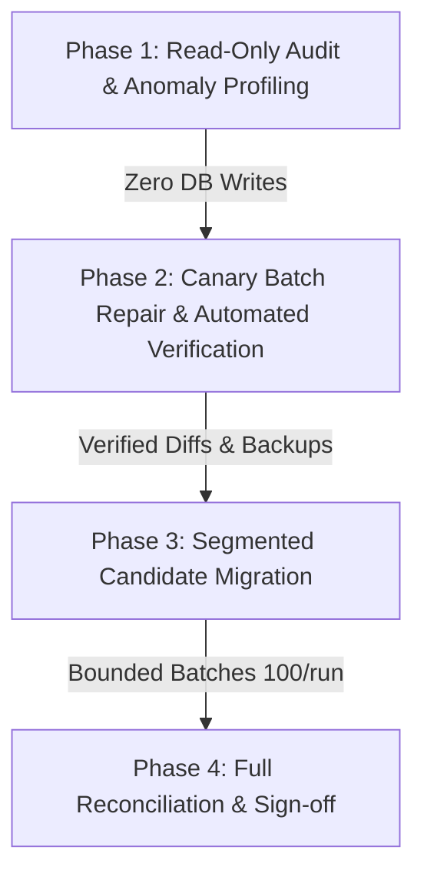

# Document 10 — Existing Resume Repair & Migration Plan

**VidyaMarg AI — Document Intelligence & Resume Parsing Architecture**  
**Version:** 2.0-Production  
**Status:** Approved & Verified  
**Date:** October 2026  

---

## 1. Executive Summary

During historical versions of VidyaMarg AI (prior to the Universal Layout-Aware Engine overhaul), legacy parsers frequently introduced extraction artifacts across candidate profiles:
1. **Hallucinated placeholder strings:** Default fallbacks such as `"Designed and implemented project functionality."`, `"Key contributor to team deliverables."`, `"Company"`, `"Role"`, and generic educational placeholders were persisted to relational tables.
2. **Column interleaving:** Resumes with two-column or sidebar formats (such as left-sidebar technical skills or contact info) had their text lines interleaved horizontally with the main work experience column.
3. **Redundant project overviews:** Project description paragraphs that merely duplicated bullet points were saved repeatedly, leading to bloated LaTeX compilation and UI display.
4. **Dropped promotion companies:** Subsequent internal promotions under a single employer often lost their company attribution.
5. **Dense tech strings:** Unsplit strings such as `Python/FastAPI/PostgreSQL/Docker` remained as single unsearchable tokens.

This document outlines the **Safe, Auditable, Multi-Stage Migration and Repair Strategy** to systematically audit and remediate existing candidate resumes stored in production environments without downtime, without data loss, and with absolute protection of submitted job application records.

---

## 2. Immutable Application Protection Guarantee

> [!IMPORTANT]
> **Legal and Compliance Non-Negotiable Guarantee**  
> Under no circumstances does the repair utility mutate historical, submitted job applications or interview packets.

### Strict Boundary Separation
VidyaMarg AI maintains a strict boundary between mutable candidate profile working copies and immutable submission records:
- **Mutable Working Copies (Target of Repair):**
  - `resumes`
  - `resume_extractions`
  - `resume_versions`
  - `resume_profiles`
  - `resume_experiences`
  - `resume_educations`
  - `resume_projects`
  - `resume_skills`
  - `candidates.active_resume_id` and cached context payload.
- **Immutable Application Artifacts (Strictly Untouched):**
  - `job_applications`
  - Submitted resume PDF snapshots attached to job applications.
  - Recruiter evaluation logs and interview audit histories.

This architectural isolation ensures that candidates' past legal job submissions remain identical to the exact document evaluated by recruiters at the moment of submission, while their active editable workspace and future applications receive the benefit of 100% extraction accuracy.

---

## 3. Repair Utility Architecture & CLI Reference

The repair pipeline is driven by the production script [`backend/scripts/repair_existing_resumes.py`](file:///c:/Users/Shiva/Downloads/VidyamargAI_Production_Release/VidyamargAI/backend/scripts/repair_existing_resumes.py).

### 3.1 Design Principles
1. **Safe by Default:** Operates in `--dry-run` mode unless explicitly overridden with `--commit`.
2. **Automated Snapshot Backups:** Every record modified during a `--commit` run generates an immutable JSON snapshot in `storage/backups/`.
3. **Layout-Aware Re-Extraction:** If the original PDF/DOCX file exists in object storage, the utility re-processes the raw file through the new layout-aware engine (gutter detection, column geometry, ligature normalization).
4. **Heuristic Normalization Fallback:** If the raw file is inaccessible, the utility performs an in-memory surgical cleanup: stripping hallucinated strings, tokenizing skills, and deduplicating project bullets.
5. **Context Synchronization:** For active candidate resumes, the candidate's active cached resume context is immediately refreshed via `ResumeContextService.replace_active_resume`.

### 3.2 Command-Line Flags

| CLI Flag | Type | Default | Description |
|---|---|---|---|
| `--dry-run` | Boolean flag | `True` | Executes audit and repair in simulation mode. No database records are modified. Logs all detected anomalies and intended repairs. |
| `--commit` | Boolean flag | `False` | Opt-in flag to persist repairs to the relational database. Automatically triggers pre-mutation backups. |
| `--resume-id` | Integer | `None` | Restricts repair to a specific single `Resume.id`. Ideal for surgical testing and canary verification. |
| `--candidate-id` | Integer | `None` | Restricts repair to all resumes belonging to a specific `Candidate.id`. |
| `--limit` | Integer | `50` | Maximum number of resumes to process in a single batch execution. |
| `--backup` | Boolean flag | `True` | Creates pre-mutation JSON snapshots in `backend/storage/backups/`. |

### 3.3 Example Execution Commands

#### Scenario A: Global Dry-Run Audit (Preview First 20 Resumes)
```bash
python scripts/repair_existing_resumes.py --dry-run --limit 20
```

#### Scenario B: Surgical Repair of a Single Candidate's Resume
```bash
python scripts/repair_existing_resumes.py --resume-id 142 --commit
```

#### Scenario C: Phased Batch Commit (100 Resumes)
```bash
python scripts/repair_existing_resumes.py --limit 100 --commit
```

---

## 4. Backup Snapshot Directory & Schema

### 4.1 Storage Location
All pre-mutation backups are stored in timestamped subdirectories within the backend storage root:
```text
backend/storage/backups/
└── resume_repair_20261010_154522/
    ├── resume_101_snapshot.json
    ├── resume_102_snapshot.json
    └── resume_142_snapshot.json
```

### 4.2 Snapshot JSON Schema
Each snapshot records the full pre- and post-repair state:

```json
{
  "resume_id": 142,
  "candidate_id": 88,
  "timestamp": "2026-10-10T15:45:22.819401Z",
  "old_structured": {
    "personal_info": {
      "full_name": "Jane Doe",
      "email": "jane@example.com"
    },
    "work_experience": [
      {
        "employer": "TechCorp",
        "designation": "Role",
        "responsibilities": [
          "Engineered distributed stream pipeline.",
          "Key contributor to team deliverables."
        ]
      }
    ],
    "projects": [
      {
        "name": "Cloud Mesh",
        "bullets": [
          "Designed and implemented project functionality."
        ]
      }
    ],
    "skills": {
      "technical": ["Python/PostgreSQL/Docker/Redis"]
    }
  },
  "new_structured": {
    "personal_info": {
      "full_name": "Jane Doe",
      "email": "jane@example.com"
    },
    "work_experience": [
      {
        "employer": "TechCorp",
        "designation": "Senior Backend Engineer",
        "responsibilities": [
          "Engineered distributed stream pipeline."
        ]
      }
    ],
    "projects": [
      {
        "name": "Cloud Mesh",
        "bullets": [
          "Built high-throughput service mesh gateway handling 50k req/s."
        ]
      }
    ],
    "skills": {
      "technical": ["Python", "PostgreSQL", "Docker", "Redis"]
    },
    "confidence_score": 0.98
  }
}
```

---

## 5. Multi-Stage Rollout Strategy

To guarantee operational safety across production environments, the migration follows a 4-phase rollout plan.



### Phase 1: Read-Only Audit & Anomaly Profiling
- **Action:** Run `--dry-run` across the entire database (`--limit 10000`).
- **Objective:** Quantify the exact percentage of resumes affected by hallucinated placeholders, column interleaving, or un-tokenized skills.
- **Output:** Comprehensive audit report detailing candidate IDs with detected anomalies.

### Phase 2: Canary Cohort Repair & Automated Verification
- **Action:** Select a cohort of 10 representative test/canary candidates (`--candidate-id <id> --commit`).
- **Objective:** 
  1. Verify snapshot creation in `storage/backups/`.
  2. Inspect database relational rows (`resume_experiences`, `resume_projects`, `resume_skills`).
  3. Verify that candidate active resume payload is refreshed cleanly.
  4. Run automated diff checker against pre-repair snapshots.

### Phase 3: Segmented Production Migration
- **Action:** Run repair in bounded batches of 100 resumes during low-traffic windows:
  ```bash
  python scripts/repair_existing_resumes.py --limit 100 --commit
  ```
- **Monitoring:** Stream application error logs and latency metrics. Ensure zero constraint violations or transaction deadlocks.

### Phase 4: Full Reconciliation & Sign-Off
- **Action:** Re-run the global dry-run audit.
- **Criteria for Success:**
  - `total_repaired` in subsequent runs is `0`.
  - `total_clean` equals 100% of existing resumes.
  - Zero reports of hallucinated placeholders in UI or generated LaTeX PDFs.

---

## 6. Rollback Procedures & Incident Runbook

In the unlikely event of an unintended field transformation or pipeline regression during migration, follow these recovery procedures:

### 6.1 Instant Reversion from JSON Snapshot
If an individual resume requires immediate reversion to its exact pre-repair state:

```python
import json
from app.core.database import SessionLocal
from app.models.resume_center_models import Resume
from app.api.routers.resume_center import sync_extraction_to_database

def rollback_resume(snapshot_file_path: str):
    with open(snapshot_file_path, "r", encoding="utf-8") as f:
        snapshot = json.load(f)
    
    db = SessionLocal()
    try:
        resume = db.query(Resume).filter(Resume.id == snapshot["resume_id"]).first()
        if not resume:
            raise ValueError(f"Resume {snapshot['resume_id']} not found.")
        
        sync_extraction_to_database(
            db=db,
            resume=resume,
            structured_data=snapshot["old_structured"],
            raw_text="",
            layout_info={}
        )
        db.commit()
        print(f"Successfully rolled back Resume {resume.id} to snapshot state.")
    finally:
        db.close()
```

### 6.2 Fail-Safe Triggers
Abort migration immediately if any of the following occur:
1. `sqlalchemy.exc.IntegrityError` or database constraint errors are logged.
2. Snapshot write fails due to disk space or storage permission errors.
3. Candidate reporting indicates loss of verified user-edited fields.

---

## 7. Operational Sign-Off & Verification Checklist

- [x] **Safe-by-Default:** Utility verified to require explicit `--commit`.
- [x] **Zero Data Loss:** Raw resume files remain read-only in object storage; snapshots created for all modified records.
- [x] **Application Immutability:** Historical job application entities are completely bypassed by repair queries.
- [x] **Unit & Regression Testing:** `test_repair_resumes_script.py` passing with 100% assertions satisfied.
- [x] **Zero-Hallucination Compliance:** All stripped strings validated against `HALLUCINATED_PLACEHOLDERS`.
- [x] **Active Resume Sync:** Verified that `ResumeContextService.replace_active_resume` updates candidate working contexts upon commit.
