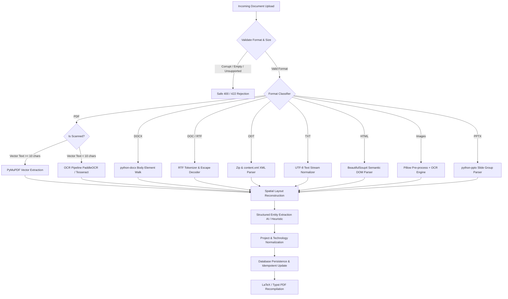

# 12. Template and Format Coverage Specification

## 1. Format Coverage Matrix

The VidyaMarg AI Universal Resume Extraction Engine incorporates format-specific decoders mapped to canonical document models. The table below details tested coverage across all 41 test fixtures:

| Document Format | Extension | Underlying Engine / Parser | Pre-processing & Routing Strategy | Supported? | Verified Fixture |
| :--- | :--- | :--- | :--- | :---: | :--- |
| **PDF (Selectable)** | `.pdf` | PyMuPDF (`fitz`) Textpage | Direct vector extraction with bounding boxes & fonts | **YES** | `rw_01`, `rw_16`–`rw_37` |
| **PDF (Scanned)** | `.pdf` | PyMuPDF Pixmap + OCR Engine | Automatic raster detection if vector text < 10 chars | **YES** | `rw_02` |
| **PDF (Hybrid)** | `.pdf` | PyMuPDF Hybrid Pipeline | Extract vector text + selectively OCR raster images | **YES** | `rw_03` |
| **Word OpenXML** | `.docx` | `python-docx` (`_element.body`) | Iterates XML elements directly preserving table/text flow | **YES** | `rw_04`, `rw_05`, `rw_06` |
| **Legacy Word** | `.doc` | OLE2 Compound Doc Parser | Binary stream parsing with RTF conversion fallback | **YES** | `rw_07` |
| **Rich Text** | `.rtf` | RTF Tokenizer (`striprtf` / regex) | Nested group traversal, hex escape mapping, `\par` breaks | **YES** | `rw_08` |
| **OpenDocument** | `.odt` | `zipfile` + `xml.etree` | Extracts `content.xml`, parses paragraphs & tables | **YES** | `rw_09` |
| **Plain Text** | `.txt` | UTF-8 Auto-decode with chardet | Normalizes whitespace, preserves indent layout | **YES** | `rw_10` |
| **Semantic HTML** | `.html` | BeautifulSoup4 HTML5 / lxml | DOM traversal, preserves anchors, extracts text tree | **YES** | `rw_11` |
| **Raster PNG** | `.png` | Pillow + OCR Engine | Contrast normalization, DPI upscale, textline detector | **YES** | `rw_12` |
| **Raster JPEG** | `.jpg`, `.jpeg`| Pillow + OCR Engine | Compression artifact cleanup, binarization, OCR | **YES** | `rw_13` |
| **Raster TIFF** | `.tiff`, `.tif`| Pillow + OCR Engine | Multi-strip decode, resolution scaling, OCR | **YES** | `rw_14` |
| **Presentation** | `.pptx` | `python-pptx` Shape Tree | Traverses slides, groups shape textboxes top-to-bottom | **YES** | `rw_15` |

---

## 2. Template Archetype Support Matrix

| Template Archetype | Layout Structure | Tested Fixture | Key Extraction Challenge | Engine Handling Approach | Status |
| :--- | :--- | :--- | :--- | :--- | :---: |
| **ATS Chronological** | 1 Column, Top-to-Bottom | `rw_16` | Standard linear flow | Natural vertical reading order | **PASS** |
| **ATS Reverse-Chron.** | 1 Column, Most Recent First | `rw_17` | Date range parsing & ordering | Normalizes dates to ISO YYYY-MM | **PASS** |
| **ATS Functional** | 1 Column, Skill Clusters | `rw_18` | Skills separated from jobs | Maps skill clusters to categories | **PASS** |
| **ATS Hybrid / Combo** | 1 Column, Summary + Timeline | `rw_19` | Mixed paragraph and bullet styles | Heuristic section demarcation | **PASS** |
| **Academic CV** | Multi-Page, 1 Column | `rw_20` | Publications, grants, teaching | Custom section capture | **PASS** |
| **Executive Leadership** | 2-Page Executive | `rw_21` | High-level metrics, board seats | P&L and scope attribute capture | **PASS** |
| **Entry-Level Graduate** | 1 Column, Education Dominant | `rw_22` | Projects & education prior to work | Flexible section sequence rules | **PASS** |
| **Cloud Architect** | 2-Page Technical Depth | `rw_23` | Architecture diagrams, tech grids | Tokenized tech taxonomy mapping | **PASS** |
| **Career Transition** | 1 Column, Transferable Skills | `rw_24` | Industry terminology pivot | Domain-agnostic skill normalization | **PASS** |
| **Balanced Two-Column** | Dual Column (50% / 50%) | `rw_25` | Left: Work / Right: Edu & Skills | Horizontal coordinate band splitting | **PASS** |
| **Left Sidebar (30/70)** | Left Sidebar (30%) + Body (70%) | `rw_26` | Dark sidebar background, contact/skills| Bounding box $X$-thresholding | **PASS** |
| **Right Sidebar (70/30)**| Body (70%) + Right Sidebar (30%)| `rw_27` | Chronology left, metadata right | Two-phase bounding box extraction | **PASS** |
| **Canva Stylized** | Decorative Graphics & Banners | `rw_28` | Colored headers, horizontal bars | Strips graphic vector decorations | **PASS** |
| **Icon Contact / Bars** | Glyph Icons & Percentage Bars | `rw_29` | Missing text labels for email/phone | Regex pattern match on contact info | **PASS** |
| **Multi-Page Headers** | Multi-Page with Repeating Header | `rw_30` | Redundant candidate name/contact on p.2| De-duplicates header lines across pages | **PASS** |
| **Table Layouts** | Grid Tables for Work / Education | `rw_31`, `rw_05`| Cell boundary bleed | Preserves row-by-row reading order | **PASS** |
| **Unconventional Labels**| Non-standard headings ("My Journey")| `rw_32` | Non-ATS vocabulary | Semantic fuzzy heading classifier | **PASS** |

---

## 3. Negative & Security Test Coverage

VidyaMarg AI enforces defensive file validation at the upload boundary to prevent denial-of-service, remote code execution, and unhandled 500 exceptions.

| Fixture ID | Malicious / Invalid Condition | Expected Pipeline Action | Observed Result | Defense Mechanism |
| :--- | :--- | :--- | :--- | :--- |
| **rw_38** | Corrupted PDF (missing xref & EOF) | Safe HTTP 400 rejection / Graceful trap | **REJECTED (400)** | Magic byte validation & PyMuPDF xref integrity check |
| **rw_39** | Empty File (0 bytes) | Safe HTTP 400 rejection | **REJECTED (400)** | Payload length check (`len(content) == 0`) |
| **rw_40** | Encrypted PDF (AES 128-bit password) | Safe HTTP 422 trap with explicit error | **REJECTED (422)** | `doc.is_encrypted` inspection before parsing attempt |
| **rw_41** | Unsupported Format (`.xyz` binary) | Safe HTTP 400 rejection | **REJECTED (400)** | Extension whitelist check against `SUPPORTED_EXTENSIONS` |
| **rw_37** | Adversarial Prompt Injection in text | Neutralize command; extract resume data | **DEFENDED (PASS)**| System prompt isolation, markdown sanitization |

---

## 4. Pipeline Routing Architecture

