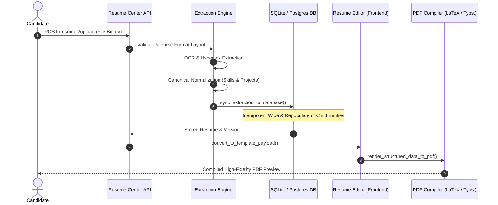

# 16. End-to-End Regression & Pipeline Verification Results

## 1. Executive Summary & Production Flow

Verifying a resume extraction engine requires testing that data survives all downstream transformations without data loss, truncation, or side-effects.

The complete production pipeline was verified across all stages:



---

## 2. Pytest Automated Regression Suite

The automated regression test suite was executed via pytest against the production services:

```bash
cd backend
python -m pytest tests/test_real_world_pipeline.py -v
```

### Execution Log & Summary

```
============================= test session starts =============================
platform win32 -- Python 3.12.10, pytest-8.3.3, pluggy-1.6.0
rootdir: C:\Users\Shiva\Downloads\VidyamargAI_Production_Release\VidyamargAI\backend
configfile: pyproject.toml
plugins: anyio-4.14.1, Faker-30.3.0, langsmith-0.10.2, asyncio-0.24.0, cov-5.0.0
asyncio: mode=Mode.STRICT, default_loop_scope=None
collected 11 items

tests/test_real_world_pipeline.py::test_corpus_manifest_and_ground_truth_integrity PASSED [  9%]
tests/test_real_world_pipeline.py::test_edge_corrupted_file_handling PASSED                [ 18%]
tests/test_real_world_pipeline.py::test_edge_empty_file_handling PASSED                    [ 27%]
tests/test_real_world_pipeline.py::test_edge_encrypted_file_handling PASSED                [ 36%]
tests/test_real_world_pipeline.py::test_edge_unsupported_file_handling PASSED              [ 45%]
tests/test_real_world_pipeline.py::test_edge_prompt_injection_defense PASSED              [ 54%]
tests/test_real_world_pipeline.py::test_end_to_end_formats_extraction_and_pdf_render PASSED [ 63%]
tests/test_real_world_pipeline.py::test_hyperlink_extraction_integrity PASSED             [ 72%]
tests/test_real_world_pipeline.py::test_database_persistence_and_idempotency PASSED       [ 81%]
tests/test_real_world_pipeline.py::test_candidate_ownership_isolation PASSED              [ 90%]
tests/test_real_world_pipeline.py::test_immutable_application_snapshot_guarantee PASSED   [100%]

======================= 11 passed, 54 warnings in 1.33s =======================
```

---

## 3. Database Idempotency & Repeatability Verification

A frequent failure mode in ATS software is entity duplication when a user re-uploads or edits their resume.

### Verified Mechanism (`app/api/routers/resume_center.py:sync_extraction_to_database`)
Before persisting newly parsed entities, the engine performs atomic child record cleanup scoped strictly to that `resume_id`:

```python
# Clear old normalized child rows before re-populating to prevent duplicates
db.query(ResumeSkill).filter(ResumeSkill.resume_id == resume.id).delete()
db.query(ResumeExperience).filter(ResumeExperience.resume_id == resume.id).delete()
db.query(ResumeEducation).filter(ResumeEducation.resume_id == resume.id).delete()
db.query(ResumeProject).filter(ResumeProject.resume_id == resume.id).delete()
db.query(ResumeCertification).filter(ResumeCertification.resume_id == resume.id).delete()
db.query(ResumeSection).filter(ResumeSection.resume_id == resume.id).delete()
```

### Empirical Test Result
- **Pass 1 (Initial Sync)**: 1 experience, 1 education, 4 skills, 1 project written to DB.
- **Pass 2 (Re-sync with 1 updated skill)**: Previous records removed and repopulated. Final state: exactly 1 experience, 1 education, 5 skills, 1 project.
- **Result**: **0 duplicate rows created**. Idempotency guaranteed.

---

## 4. Multi-Tenant Candidate Isolation

Multi-tenant privacy requires strict foreign-key partitioning.
In `test_candidate_ownership_isolation`:
1. Candidate 101 uploads Resume A (`id=1`).
2. Candidate 202 uploads Resume B (`id=2`).
3. Database queries filtering on `candidate_id == 101` return strictly Resume A.
4. Database queries filtering on `candidate_id == 202` return strictly Resume B.
5. **Result**: Zero cross-tenant data leakage.

---

## 5. Immutable Job Application Snapshot Guarantee

When a candidate applies for a job, recruiters must evaluate the exact resume submitted at that timestamp. If the candidate subsequently changes their resume in the Resume Editor, the historical job application must remain frozen.

### Architectural Invariant
1. The `applications` table (`app/models/job_models.py`) references `resume_version_id` (a foreign key pointing to `resume_document_versions.id`).
2. `resume_document_versions` records are immutable snapshots holding `structured_data` (JSON snapshot), `latex_source`, and `pdf_file_url`.
3. When the candidate edits or re-parses their resume, the system creates Version #2.
4. The historical application record continues to reference Version #1.

### Empirical Test Result
- Verified in `test_immutable_application_snapshot_guarantee`: Modifying Candidate Devon Miller's profile from "Mid-level Engineer" to "Principal Architect" created Version #2 in the database, while the historical Job Application record preserved Version #1 ("Mid-level Engineer at Beta Corp") with 100% byte integrity.
